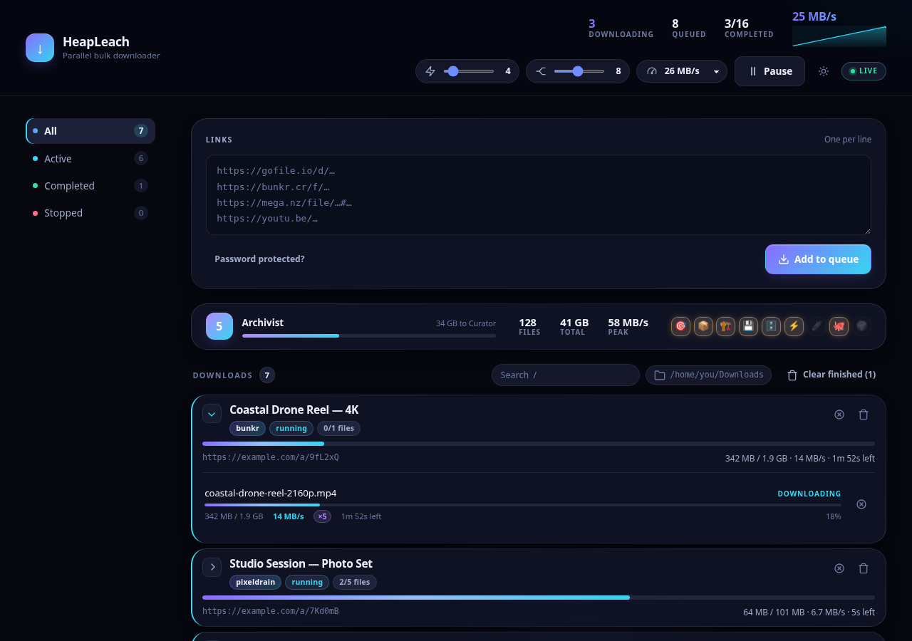
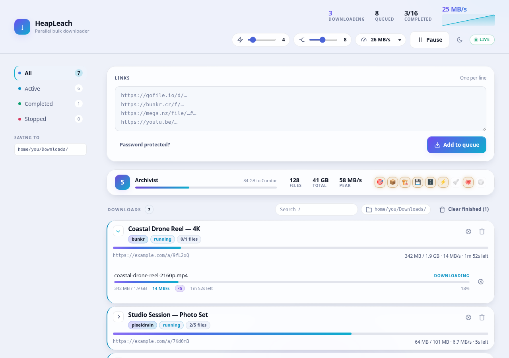
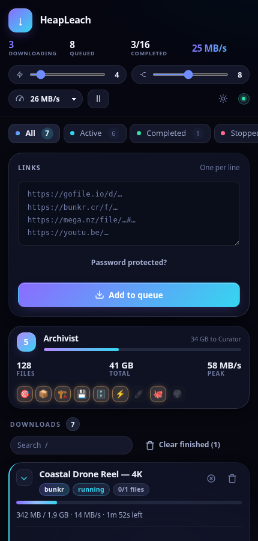
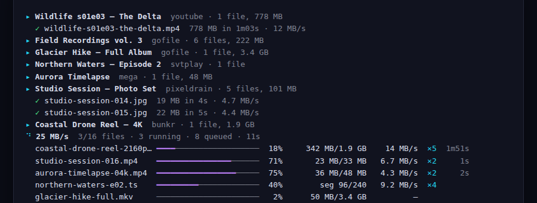

# HeapLeach

**Paste a heap of links. Download them together.**

A bulk download manager for **180+ sites**, with a web UI and a command-line
mode. Expand albums, folders and playlists into a queue, download files in
parallel, and resume interrupted transfers. Runs on **Linux, macOS, Windows
and Docker**; the web UI is built into the executable.

[](https://github.com/JohanLindvall/HeapLeach/actions/workflows/ci.yml)
[](https://github.com/JohanLindvall/HeapLeach/releases/latest)
[](LICENSE)

[**Download**](https://github.com/JohanLindvall/HeapLeach/releases/latest) ·
[Quick start](#quick-start) · [Documentation](docs/README.md) ·
[Supported sites](#supported-links) · [Contribute](CONTRIBUTING.md) ·
[Get help](SUPPORT.md)

<p align="center">
  <picture>
    <source media="(prefers-color-scheme: light)" srcset="docs/screenshot-light.png">
    
  </picture>
</p>

## Why HeapLeach?

- **Batch downloads:** paste one link per line; supported albums, folders and
  playlists expand automatically.
- **Resumable transfers:** keep partial files, retry failures, and continue
  after an interruption.
- **Control your bandwidth:** adjust parallel downloads, connections per file
  and the native download speed limit while the queue runs.
- **A queue you can navigate:** search, filter, pause, retry individual files,
  and inspect logs from the browser. Light, dark and mobile layouts included.
- **Desktop or automation:** open the local web UI, pass URLs to the CLI,
  or run the Docker image on your server.
- **One application:** Go backend and embedded React UI. Releases include
  local CAPTCHA model data; Docker also includes the media helpers.

## Quick start

### Download and run

1. Open the [latest release](https://github.com/JohanLindvall/HeapLeach/releases/latest)
   and choose the archive for your system:

   | System | Archive ending |
   | --- | --- |
   | Linux, Intel / AMD 64-bit | `linux_amd64.tar.gz` |
   | Linux, ARM64 | `linux_arm64.tar.gz` |
   | macOS, Apple silicon | `darwin_arm64.tar.gz` |
   | macOS, Intel | `darwin_amd64.tar.gz` |
   | Windows, Intel / AMD 64-bit | `windows_amd64.zip` |

2. Extract the **whole archive** into a folder. Keep `ocr/` beside the
   executable. No Go or Node.js installation is needed.
3. Run `heapleach` (`heapleach.exe` on Windows). It opens your browser and
   saves to your Downloads folder.
4. Paste your links, one per line, and click **Add to queue**.

<details>
<summary>Terminal commands for Linux, macOS and Windows</summary>

Run these from a folder containing only the archive version you want to use.

```bash
# Linux x86-64; use linux_arm64 for an ARM64 machine.
tar -xzf heapleach_*_linux_amd64.tar.gz
./heapleach
```

```bash
# macOS Apple silicon; use darwin_amd64 for an Intel Mac.
tar -xzf heapleach_*_darwin_arm64.tar.gz
./heapleach
```

```powershell
# Windows PowerShell
Expand-Archive -Path .\heapleach_*_windows_amd64.zip -DestinationPath .\heapleach
.\heapleach\heapleach.exe
```

</details>

An argument-free launch uses a free local port. After you close the browser,
it exits once downloads are idle and no tab has connected for a minute.
Unfinished jobs return **held** after a restart; click **Resume** to continue.

See [installation and updates](docs/installation.md) for checksums, Docker
persistence, source builds and platform notes.

### Docker

On Linux or macOS with Docker, run:

```bash
mkdir -p "$HOME/Downloads"
docker run --rm -it --name heapleach \
  -p 127.0.0.1:8080:8080 \
  --user "$(id -u):$(id -g)" \
  -e HEAPLEACH_STATE=/downloads/.heapleach-state/queue.json.zst \
  -v "$HOME/Downloads:/downloads" \
  ghcr.io/johanlindvall/heapleach:latest
```

Open **[localhost:8080](http://localhost:8080)**. Downloads and queue state stay
in your Downloads folder when the container stops. The image supports amd64
and arm64 and includes yt-dlp, ffmpeg, ffprobe, deno and local OCR.

The web UI has no login. The command above publishes it only on your computer;
see [network access](#network-access-and-trust) for remote deployments.

## Usage

<a id="on-the-command-line"></a>

```bash
# Open the UI on a free local port and choose the destination.
./heapleach -addr 127.0.0.1:0 -open ~/Downloads

# Download a list of URLs, then exit. Blank lines and # comments are ignored.
./heapleach - ~/Downloads < urls.txt

# Limit native download speed and parallel transfers.
./heapleach -addr 127.0.0.1:8080 -concurrency 4 -max-speed 10MB ~/Downloads

# Show every command-line option.
./heapleach -help
```

`urls.txt` contains your own URLs, one per line. On PowerShell, use
`Get-Content .\urls.txt | .\heapleach.exe -` to feed a list to the CLI.
To pass URLs directly, quote each one, especially links containing `&` or `#`.

The CLI exits `0` on success, `1` if any input or download fails, and `130`
after Ctrl-C. Partial files remain available for resume. Native transfers
honor the shared speed limit; external helpers use their own controls.

[Full usage guide](docs/usage.md) · [Configuration](#configuration) ·
[Troubleshooting](SUPPORT.md)

## Supported links

File hosts, image galleries, video sites, broadcasters, image boards and
compatible platforms are supported, including:

| Content | Examples |
| --- | --- |
| Files and folders | gofile, bunkr, MEGA, pixeldrain, MediaFire, Dropbox |
| Video and playlists | YouTube through yt-dlp, Vimeo, PeerTube |
| Broadcasts | SVT Play and other supported broadcasters |
| Galleries and collections | Chevereto, image boards, Internet Archive |
| Direct and embedded media | File URLs, HLS/DASH playlists, open directories, supported links embedded in webpages |

<a id="image-boards"></a>

Some workflows need [optional helpers](#optional-helpers). Support depends on
what a host makes available; see [accepted URL formats and limitations](docs/supported-links.md).
Sites change, so fixture tests alone cannot guarantee current live support.

### Every supported site

<details>
<summary>Expand the complete site inventory, generated from the extractor registry</summary>

<!-- BEGIN HOSTS -->
<!-- Generated by `make hosts`. Do not edit by hand. -->

197 sites across 105 extractors, plus 6 that match by shape rather than by host.

| Extractor | Sites |
|---|---|
| `4chan` | `4chan.org`, `4channel.org` |
| `abclisten` | `abc.net.au/listen` |
| `alohatube` | `alohatube.com` |
| `archive.org` | `archive.org` |
| `ard` | `ardmediathek.de` |
| `arte` | `arte.tv` |
| `balbums` | `balbums.st` |
| `bandcamp` | `bandcamp.com` |
| `bbcsounds` | `bbc.co.uk/sounds` |
| `bilibili` | `b23.tv`, `bilibili.com` |
| `bitchute` | `bitchute.com` |
| `blender` | `video.blender.org` |
| `booru` | `aibooru.online`, `booru.borvar.art`, `booru.foalcon.com`, `booru.org`, `derpibooru.org`, `e621.net`, `e6ai.net`, `e926.net`, `furbooru.org`, `hypnohub.net`, `konachan.com`, `konachan.net`, `ponybooru.org`, `safebooru.org`, `sakugabooru.com`, `snootbooru.com`, `tbib.org`, `twibooru.org`, `xbooru.com`, `yande.re` |
| `bunkr` | `bunkr.*` |
| `camwhores` | `camwhores.tv` |
| `celeb` | `celeb.st` |
| `civitai` | `civitai.com` |
| `coomerfans` | `coomerfans.com` |
| `cyberdrop` | `cyberdrop.cr` |
| `dailymotion` | `dai.ly`, `dailymotion.com` |
| `desuarchive` | `desuarchive.org`, `rbt.asia` |
| `doodstream` | `d000d.com`, `d0o0d.com`, `do0od.com`, `dood.la`, `dood.li`, `dood.re`, `dood.sh`, `dood.so`, `dood.to`, `dood.watch`, `dood.ws`, `dood.yt`, `doodstream.com`, `dooood.com`, `ds2play.com`, `playmogo.com`, `vidply.com` |
| `drive` | `docs.google.com`, `drive.google.com`, `drive.usercontent.google.com` |
| `dropbox` | `dropbox.com`, `dropboxusercontent.com` |
| `drtuber` | `drtuber.com` |
| `drtv` | `dr.dk` |
| `emload` | `emload.com` |
| `eporner` | `eporner.com` |
| `erome` | `erome.com` |
| `fapello` | `fapello.com` |
| `fapster` | `fapster.xyz` |
| `fileboom` | `fboom.me` |
| `filejump` | `filejump.com` |
| `filester` | `filester.*` |
| `framatube` | `framatube.org` |
| `francetv` | `france.tv` |
| `freeimage` | `freeimage.host` |
| `gifyu` | `gifyu.com` |
| `gofile` | `gofile.io` |
| `imagepond` | `imagepond.net` |
| `imgbb` | `ibb.co`, `imgbb.com` |
| `imgur` | `imgur.com` |
| `keep2share` | `k2s.cc`, `keep2share.cc` |
| `kemono` | `coomer.party`, `coomer.st`, `coomer.su`, `kemono.cr`, `kemono.party`, `kemono.st`, `kemono.su` |
| `knuthing` | `knuthing.com` |
| `kolektiva` | `kolektiva.media` |
| `lulustream` | `lulustream.com`, `luluvdo.com`, `luluvido.com` |
| `makertube` | `makertube.net` |
| `mediafire` | `mediafire.com` |
| `mega` | `mega.co.nz`, `mega.nz` |
| `mixcloud` | `mixcloud.com` |
| `mixdrop` | `mdbekjwqa.pw`, `mixdrop.ag`, `mixdrop.bz`, `mixdrop.ch`, `mixdrop.club`, `mixdrop.co`, `mixdrop.gl`, `mixdrop.is`, `mixdrop.my`, `mixdrop.ps`, `mixdrop.sx`, `mixdrop.to`, `mixdrp.co`, `mixdrp.to` |
| `moannest` | `moannest.com` |
| `niconico` | `nico.ms`, `nicovideo.jp` |
| `noodlemagazine` | `noodlemagazine.com` |
| `npo` | `npo.nl`, `npostart.nl` |
| `npr` | `npr.org` |
| `nrk` | `tv.nrk.no` |
| `odysee` | `lbry.tv`, `odysee.com` |
| `ok.ru` | `odnoklassniki.ru`, `ok.ru` |
| `orf` | `on.orf.at`, `orf.at`, `tvthek.orf.at` |
| `palanq` | `archive.palanq.win` |
| `pbs` | `pbs.org` |
| `pixeldrain` | `nova.storage`, `pixeldrain.com` |
| `pixhost` | `pixhost.to` |
| `pornhits` | `pornhits.com` |
| `pornhub` | `pornhub.com` |
| `pornone` | `pornone.com` |
| `pornpics` | `pornpics.com` |
| `porntrex` | `porntrex.com` |
| `pornzog` | `pornzog.com` |
| `radio-canada` | `ici.radio-canada.ca`, `radio-canada.ca` |
| `raiplay` | `raiplay.it` |
| `redgifs` | `redgifs.com` |
| `rtbf` | `auvio.rtbf.be`, `rtbf.be` |
| `rtpplay` | `rtp.pt` |
| `rtve` | `rtve.es` |
| `rumble` | `rumble.com` |
| `ruv` | `ruv.is` |
| `sendvid` | `sendvid.com` |
| `sexvid` | `sexvid.xxx` |
| `soundcloud` | `soundcloud.com` |
| `spectra` | `spectra.video` |
| `srf` | `playsuisse.ch`, `srf.ch` |
| `streamable` | `streamable.com` |
| `streamtape` | `strcloud.link`, `streamta.pe`, `streamtape.cc`, `streamtape.com`, `streamtape.net`, `streamtape.site`, `streamtape.to`, `streamtape.xyz` |
| `suvobox` | `suvobox.com` |
| `svtplay` | `svtplay.se` |
| `tchncs` | `tube.tchncs.de` |
| `thisvid` | `thisvid.com` |
| `tilvids` | `tilvids.com` |
| `tnaflix` | `tnaflix.com` |
| `turbo` | `turbo.cr`, `turbocdn.st` |
| `vidmoly` | `vidmoly.biz`, `vidmoly.me`, `vidmoly.net`, `vidmoly.to` |
| `vids.st` | `vids.st` |
| `vimeo` | `player.vimeo.com`, `vimeo.com` |
| `voyeurking` | `voyeurking.com` |
| `vrtmax` | `vrt.be` |
| `wetransfer` | `we.tl`, `wetransfer.com` |
| `xhamster` | `xhamster.*` |
| `xxthots` | `xxthots.com` |
| `yandex` | `yandex.*` |
| `yle` | `areena.yle.fi`, `arenan.yle.fi` |
| `youtube` | `youtu.be`, `youtube-nocookie.com`, `youtube.com` |
| `zdf` | `zdf.de` |

And these match a URL or document shape, so the set of sites they reach is open-ended:

| Extractor | Recognises |
|---|---|
| `autoindex` | an open directory listing (Apache, nginx, lighttpd) |
| `fediverse` | an instance publishing `/.well-known/nodeinfo` — Mastodon, Pleroma, Pixelfed, Lemmy, Misskey |
| `feed` | an RSS or Atom feed, by its enclosures |
| `hls` | an adaptive manifest (`.m3u8`), from any host |
| `links` | a `links:<url>` prefix — every supported link on the page |
| `mediawiki` | any wiki with an open `api.php` — Commons, Wikipedia, Fandom |
<!-- END HOSTS -->

</details>

## Features

See the [feature guide](docs/usage.md#features) for transfer behavior, queue
controls, naming, image-board support and recovery details.

## Screenshots

<details>
<summary>Light theme, mobile layout and terminal mode</summary>

<p align="center">
  
  
</p>

<p align="center">
  
</p>

Use `-debug=false` for animated terminal progress. Debug logs are enabled by
default; pipes and log files always receive plain progress lines.

</details>

## Documentation

Start with the [documentation index](docs/README.md). If you are reading this
inside a release archive, the full [online documentation](https://github.com/JohanLindvall/HeapLeach/tree/main/docs)
is available on GitHub.

### Configuration

[Flags and environment variables](docs/configuration.md) cover download
locations, concurrency, bandwidth, queue state and proxy settings. Flags take
precedence over environment variables.

### Optional helpers

[Media helpers, local OCR and proxies](docs/helpers.md) explains which
workflows need extra tools, how to install them, and their platform limits.
The Docker image includes them.

### HTTP API

Use the [HTTP API reference](docs/api.md) to submit downloads, change settings
or consume the event stream.

### Network access and trust

HeapLeach is a single-user service without authentication. Anyone who can reach
its API can inspect the queue, submit downloads and change the destination.
Use a loopback address locally; remote access needs an authenticated HTTPS
reverse proxy and restricted access to the backend port.
[Read the network guide](docs/usage.md#network-access-and-trust).

### Architecture

<a id="what-happens-to-a-link"></a>
<a id="what-may-depend-on-what"></a>

The [architecture guide](docs/architecture.md) follows a URL from extraction
to disk and explains the package dependency rules.

## Development

To try a source build on Linux, install Git, GNU Make and Docker, then:

```bash
git clone https://github.com/JohanLindvall/HeapLeach.git
cd HeapLeach
make build
./bin/heapleach
```

Docker produces a Linux executable. On macOS or Windows, use the
[prebuilt release](https://github.com/JohanLindvall/HeapLeach/releases/latest),
run the Docker image, or follow the [native development setup](CONTRIBUTING.md#development-setup).

For hot reload, install the Go toolchain and Node.js 24, run `npm ci` in
`frontend/`, then `make dev` from the root. See
[CONTRIBUTING.md](CONTRIBUTING.md) for the complete setup and checks, and
[the development reference](docs/development.md) for build targets and releases.

<a id="layout"></a>
<a id="adding-a-host"></a>
<a id="releases"></a>

Jump to [source layout](docs/development.md#layout),
[adding a host](docs/development.md#adding-a-host) or
[release packaging](docs/development.md#releases).

## Contributing

Bug reports, documentation improvements, UI fixes and new extractors are
welcome. You do not need to know the whole codebase to help.

- [Read the contribution guide](CONTRIBUTING.md) for setup and suggested starting points.
- [Report a bug or request a feature](https://github.com/JohanLindvall/HeapLeach/issues/new/choose).
- [Get help](SUPPORT.md) or [report a vulnerability privately](SECURITY.md).
- Follow the [code of conduct](CODE_OF_CONDUCT.md).

If HeapLeach is useful to you, **star the repository** to help others find it.
Sharing a clear bug report or a small improvement helps the project too.

<details>
<summary>Star history</summary>

<a id="star-history"></a>

<a href="https://www.star-history.com/#johanlindvall/heapleach&Date">
  <picture>
    <source media="(prefers-color-scheme: dark)" srcset="https://api.star-history.com/svg?repos=johanlindvall/heapleach&type=Date&theme=dark">
    
  </picture>
</a>

</details>

## About the name

<details>
<summary>Why “HeapLeach”?</summary>

Heap leaching is a mining method: crushed ore is piled
into a heap and irrigated from above, and the solution percolates down
through it, dissolving out the metal as it goes and draining to a pad at
the bottom. This does the same to a heap of links. The extractors percolate
through whatever the pages are made of — players, listings, signed
redirects, encrypted payloads — and what is worth keeping drains out into a
folder.

</details>

## Notes

The [operating notes](docs/usage.md#operating-notes) explain queue checkpoints,
partial files and live-site tests. Use modest concurrency and respect host
limits.

## License

HeapLeach is [MIT licensed](LICENSE). Bundled OCR assets and external media
helpers retain their own licenses; see the notices in `ocr/` and the
[OCR packaging guide](helpers/captcha/README.md).
