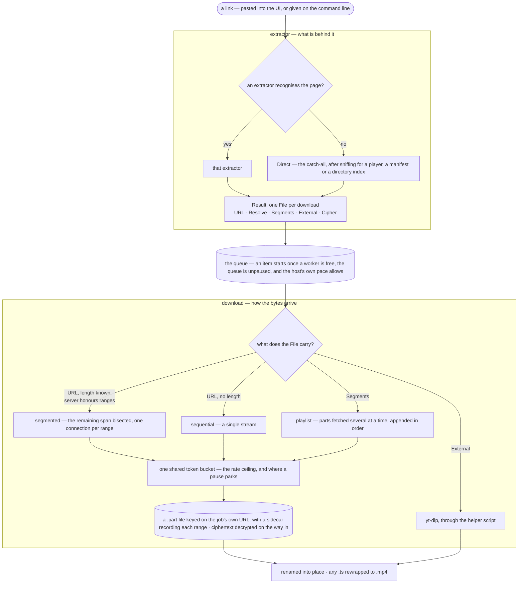
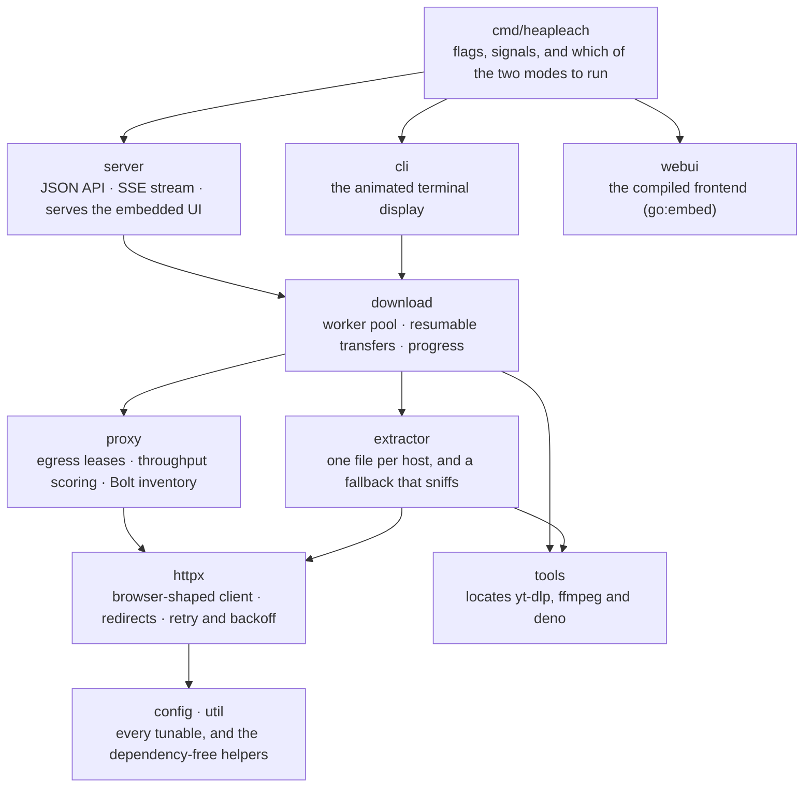

# Architecture

[Documentation](README.md) · [Project home](../README.md)

Two diagrams, for the two questions worth answering: what happens to a link,
and what is allowed to depend on what.

### What happens to a link

The middle of this is the part worth knowing. An extractor downloads nothing —
it returns one `File` per download, and the **shape of that `File` is what
decides everything downstream**. A plain `URL` reaches the segmented engine. A
`Resolve` closure instead of a URL means the host signs its links and they
expire, so one is minted per attempt rather than while the item sat in a queue.
`Segments` means the media arrives as an ordered list of parts with no length
to range over. `External` means reaching it needs more than HTTP. `Cipher`
means the bytes arrive encrypted and are decrypted on the way in.

Adding a host is choosing among those shapes; nothing below the extractor has
to be told which host it is talking to.

Two details in there are load-bearing rather than incidental. The `.part` file
is named from a hash of **the job's own source URL** rather than from anything
per-run or per-item, which is what lets an interrupted transfer be recognised
by the next run instead of restarting from zero — a signed media link would
change every time and resume nothing. And the token bucket is genuinely one
object shared by every connection, which is why pausing costs nothing and why
the code that opens extra connections has to ask whether the ceiling, rather
than the host, is what is holding a transfer back.

### What may depend on what

Arrows are imports — the layering rather than every edge, since a package may
reach anything below it. What matters is that nothing points back up. `webui`
sits outside the stack altogether: it carries the compiled frontend and no
logic, so only the entry point touches it.

Both halves of the program drive the same `download.Manager`: the server
subscribes to it and streams whole state snapshots to the browser, and the
headless run polls it on a ticker of its own. Nothing about a transfer knows
which of the two is watching.
