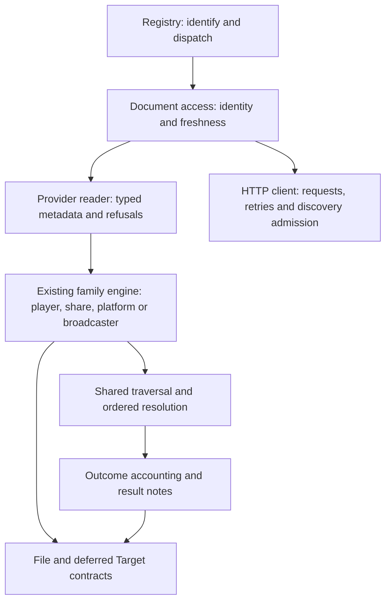

# Scraper consolidation plan

[Documentation](README.md) · [Architecture](architecture.md) ·
[Extractor guide](agents/extractors.md)

Status: proposed. Reviewed on 2026-10-31. This is an implementation plan;
its checkboxes describe future work.

## Recommendation

Consolidate **decisions that should have one owner**: whether a page can be
reused, when a retry must fetch again, how a listing reports its end, and how
much discovery I/O one extraction can start. Extend the existing engines with
small, typed readers. Keep each provider's protocol, selection rules and
naming beside its parser.

The next work should be, in order:

1. Carry forward the completed adoption work described below, and fix the
   reproduced interaction between cached pages and semantic retries.
2. Share page acquisition and parsing in the remaining simple player readers.
3. Replace broad listing `quiet` rules with explicit completion policies.
4. Bound nested discovery requests at the HTTP boundary.
5. Consolidate the small remaining media-finalization families where the
   policies actually agree, then remove obsolete adapters.

A successful consolidation makes a future fix land in one place while keeping
provider behavior visible. The number of extractor structs, files or lines
removed is a secondary measure. An abstraction requiring many exceptions to
preserve existing behavior should be narrowed or abandoned.

## Baseline and work already completed

The detailed audit used `consolidation-adoption` at
`b09b765c787796824e2d0981b98793d2335e1957`. That tree contains `main` at
`dd825f7d5a42a7a4426c1c09ac1455ae1e072495`, plus completed adoption work.
The documentation is being saved on `main`; the adoption branch's code is a
separate integration step. Source links below point to files, and symbol names
identify the intended code even where the two revisions differ.

The reviewed tree has 112 production extractor Go files, 42,221 physical lines,
and 121 tracked Go test files. These counts exclude private live-test symlinks.
There are 17 rows in `playerSites` and 13 `shareSite` declarations. These are
scope measurements, not estimates of removable code.

### Carry forward existing work before building on it

| Existing adoption work | Commits | Effect on this plan |
| --- | --- | --- |
| Retain complete item outcomes through source expansion and archive indexes | `87bbfb6`, `ad9788d` | Use `outcomeSummary`, `expansion.note` and `expansion.unresolved`; preserve the newer failure and child-incompleteness notes. |
| Read the probe's parsed tree in more collection readers | `86b3fce` | CoomerFans, PornPics and Chevereto join the NPR/ABC listen pilots; start subsequent adoption elsewhere. |
| Carry typed pagination completion into folder trees | `8cc3fae` | Build on `walkEnd` and `treeWalk.ended`; retain the existing note rendering. |
| Record the extractor choice rules and adoption status | `c151b3f` | Retain the choice table and exception notes in the extractor guide. |

Review these commits against the current `main` and integrate their code,
tests and area-guide changes as one coherent prerequisite. Resolve the plan
file separately: the old plan was subsequently deleted on that branch, and
this document replaces it. Do not let that deletion remove the new plan.
This document itself performs no code integration.

### Existing owners to extend

Paths in this table are relative to `backend/internal/extractor/`.

| Responsibility | Existing implementation | Provider responsibility |
| --- | --- | --- |
| Recognition and precedence | [extractor.go](../backend/internal/extractor/extractor.go), `NewRegistry`, `about` | Specific URL forms, structural fingerprints, bounded API identification and registration position |
| Borrowed documents and API answers | [page.go](../backend/internal/extractor/page.go), [platform.go](../backend/internal/extractor/platform.go) | Request identity, whether a fresh response is required, schema and target validation |
| Ordinary video pages | [players.go](../backend/internal/extractor/players.go), [playersites.go](../backend/internal/extractor/playersites.go) | Canonicalization, player reader, referer, candidate metadata and signing policy |
| Stateless shares | [shares.go](../backend/internal/extractor/shares.go) | Ordered forms and extraction callback |
| External and indirect sources | [handoffs.go](../backend/internal/extractor/handoffs.go), [pointers.go](../backend/internal/extractor/pointers.go) | Helper requirements and destination discovery |
| Pagination and folder trees | [pages.go](../backend/internal/extractor/pages.go), [listing.go](../backend/internal/extractor/listing.go), [tree.go](../backend/internal/extractor/tree.go) | One page or folder, cursor updates, item identity and evidence of completion |
| Ordered resolution and accounting | [resolve.go](../backend/internal/extractor/resolve.go), [fanout.go](../backend/internal/extractor/fanout.go) | One item and its typed refusal |
| Collection and series results | [sources.go](../backend/internal/extractor/sources.go), [broadcast.go](../backend/internal/extractor/broadcast.go), [notes.go](../backend/internal/extractor/notes.go) | Stable folders, seasons, vocabulary and deliberate omission policy |
| Media and refresh | [hls.go](../backend/internal/extractor/hls.go), `File.target`, `Target.file`, `refreshing`, `signedResult` | Rendition choice, signing cadence and route-bound control hooks |
| Payload reading and credentials | [html.go](../backend/internal/extractor/html.go), [jsdecode.go](../backend/internal/extractor/jsdecode.go), [renewable.go](../backend/internal/extractor/renewable.go) | Typed payload schemas, credential identity, expiry and refusal interpretation |

Keep the helpers in the existing extractor package during this work. Moving
providers to subpackages now would require exporting or moving the private
helpers they already share. Dependency-free utilities belong in
`internal/util`, transport mechanics in `internal/httpx`, and tunable values
in `internal/config/limits.go`.

## Intended division of responsibility



This is an ownership map, not a requirement that every extractor pass through
all boxes. A standalone video has no collection walk. An API-first platform
may not read HTML. A signed-link handshake remains a provider reader used by
the existing player engine.

Keep recognition, discovery and transfer-time resolution distinct. Sharing a
parser between them must not make recognition mint a token, make discovery
open every listed video, or let a queued file retain an expired target.

## Priorities

Effort is relative: S is a bounded helper and a few callers; M crosses a family;
L crosses extraction and transport contracts. It includes tests and guide
updates, and is not a calendar estimate.

| ID | Priority | Change | Evidence / expected benefit | Effort and dependency |
| --- | --- | --- | --- | --- |
| A | P0 | Integrate completed adoption | Avoid recreating work or losing its diagnostics | M; baseline prerequisite |
| B | P0 | Explicit freshness for page reuse and retries | Reproduced retry failure; one owner for an otherwise scattered policy | M; initial fix can proceed independently of A |
| C | P1 | Reusable document readers and parsed payloads | Repeated fetch/parse/title glue; duplicate player decoding | M; B, and A for the expanded reuse tests |
| D | P1 | Explicit listing completion policy | `quiet` currently hides several unrelated stop reasons | M; A |
| E | P1 | Shared discovery request admission | Nested map fixture reaches 36 and 72 concurrent leaves | L; measure actual HTTP I/O before choosing limits |
| F | P2 | Narrow broadcaster media finalization | Repeated playlist-to-file tails with several distinct extension rules | S–M; existing media contracts |
| G | P2 | Harden engine rows and finish adoption | Shared mechanics need shared validation and a clear deletion list | S–M; accompany B–F |
| H | Defer | More struct-to-row conversions and package splits | Small wrapper savings; potentially large semantic changes | Reconsider only with measured, concrete duplication |

### B. Give page freshness one owner

**Observed source.** `fetchDocument` and `fetchRoot` reuse a successful probe
for the requested URL. `fetchPage` delegates to `fetchDocument`.
`withExtractRetries` calls a closure repeatedly, and `okruRead` captures the
same context for every `okruFetch`. If that context holds a successful page
with an empty rendition list, each retry receives the same page again.
Relevant code: [page.go](../backend/internal/extractor/page.go),
[retry.go](../backend/internal/extractor/retry.go),
[okru.go](../backend/internal/extractor/okru.go).

**Reproduced behavior.** A temporary synthetic test served an empty player
whose status was `OK` on the first request and a playable configuration on
every subsequent request. It used the real registry with a copied player row;
only canonicalization was changed to retain the local test server's URL.
Registry extraction made **one HTTP request and failed after its retries**.
Calling `okruRead` without a probed page made **two requests and succeeded**,
returning four candidates. No live service or media transfer was involved.
The temporary test was removed after the audit. The relevant production files
are identical in the two reviewed revisions.

The same helper has three production callers: `okruRead`, `doodRead` and the
Civitai listing reader. Inspect each call when changing the retry contract;
the reproduction establishes the first case, not that all three are broken.

**Implementation steps:**

- [x] Add a shared, explicit way to request a fresh document, bypassing the
  extraction's attached probe without discarding cancellation, route,
  cookie-jar, logging or challenge-capture context.
- [x] Let retry callbacks receive an attempt context or explicit read mode.
  The first attempt may reuse the probe; a retry of a semantically invalid
  response must perform a fresh request. Callbacks must use the supplied
  context instead of retaining the original one.
- [x] Keep `httpx.Client.Do` responsible for transport retries and 429 waits.
  `withExtractRetries` remains responsible for a successful response whose
  contents require another attempt. Do not multiply either budget.
- [x] Define freshness for `peek`, signed refresh and canonical probes in the
  same vocabulary, while retaining their existing schedules.
- [x] Add the synthetic scenario above as a permanent regression test that
  expects successful registry extraction and two requests after the fix.

**Representation identity needs an explicit contract too.** The current
`fetchDocument` reuse branch does not compare its `headers` argument with the
probe's request. `pageJSON` memoizes by endpoint alone. Those APIs are safe only
where the caller knows the response is the same representation; generalizing
their use without that assumption is unsafe.

Add a documented reuse decision covering method, requested URL, request body,
representation-changing headers, session identity and route. Prefer explicit
provider opt-in or a small request descriptor over hashing arbitrary context
values. A changed User-Agent, authenticated session, POST body or route must
not borrow another representation. A provider may declare that its referer
does not change its page; make that decision visible at the call site.
Do not key shared caches on logged or persisted raw credentials.

Acceptance cases: same page reused once; fresh retry sees changed metadata;
changed route/session/User-Agent receives its own response; canonical aliases
reuse only their validated canonical page; a cancelled retry starts no request;
transfer-time refresh replaces every media field. Preserve the existing
bounded probe, error and challenge rules.

### C. Share document readers before adding another scraper engine

The engine already owns candidate selection, HLS resolution, deferred files
and error context. The remaining repetition is mostly inside its readers.

| Candidate | Current repetition | Proposed change | Compatibility condition |
| --- | --- | --- | --- |
| Simple inline rows in `playersites.go` | Fetch page, read title, parse a source, assemble `playerVideo` | A small page-reader adapter around provider parsing | Request headers and fallback title order remain explicit |
| `luluPlayer` / `luluSource` | Recognition decodes the source; extraction decodes it again; heading and title helpers parse separately | Memoize the pure source decode for the same `Page`; read headings/title from one tree | Canonical URL changes and fresh signing produce a new read |
| `rajceAlbumData` | Parses a string even when a borrowed tree is available | Add a root-based reader; retain a thin string adapter for fixtures | Raw script whitespace, media order and final referer are unchanged |
| `okruMetadataFrom` | String entry point always reparses the document | Root-based payload reader behind the explicit freshness contract | An empty but `OK` player must still fetch again |
| `pageTitle` / `firstHeading` callers | Each convenience helper can parse the same body | Root-based title access at callers already needing a DOM | Keep each provider's suffix and whitespace rules |

Use [celeb.go](../backend/internal/extractor/celeb.go)'s `celebProbedData` as the
existing model for sharing a decoded payload between recognition and
extraction. It uses `memo`, retains the parse error, and treats the result as
immutable. Use [docreuse_test.go](../backend/internal/extractor/docreuse_test.go)
for the existing string/tree parity and benchmark pattern.

**Shape of the change:**

- [x] Keep a provider parser as an ordinary function taking a tree and/or raw
  body plus the final URL. It returns typed metadata or `playerVideo`.
- [x] Introduce a page-reading adapter only after two simple rows fit it.
  It owns acquisition, the B freshness decision, optional tree access and
  shared error wrapping. Start with the straightforward body-based rows;
  retain the existing custom `read` function for API and handshake readers.
- [x] Use `Page.HTML()` or `fetchRoot` when a tree already exists. Keep raw
  body access for regex and JavaScript readers; do not force a DOM parse on
  a reader that only scans script text.
- [x] Keep title fallback order in each parser. `cmp.Or` evaluates all its
  arguments, so composing string helpers can parse both the heading and
  title even when the heading already supplied the answer.
- [x] Memoize only pure parsing of the exact page. Store immutable values;
  copy slices or maps before any ranking or mutation. A fresh page gets its
  own parse result. Provider-specific memo keys must not collide.
- [x] Retain string entry points only where tests or independent readers need
  them; those entry points parse and delegate rather than duplicate logic.
- [x] Remove the old acquisition/title/decoding glue at each migrated caller.

The adapter must accommodate direct `Extractor.Extract` tests with no attached
probe, as well as registry-driven extraction. Do not strengthen recognition to
require a playable video merely to share a parser: a recognizably removed or
restricted page still belongs to its provider and must return its refusal.

**Do not force into the pilot:** API-only readers, DoodStream and Noodlemagazine
handshakes, Bandcamp's request identity, Niconico metadata carried by error
responses, or WordPress's mutable private tree. They can reuse individual
parsing primitives without sharing the whole acquisition sequence.

**Outcome.** Nine player rows use `parse` over `readPlayerPage`; CoomerFans,
PornPics, Chevereto and ok.ru read the root through `fetchRoot`, and
LuluStream memoises its unpacked source. `rajceAlbumData` was evaluated and
left on its own parse: its recogniser never builds a tree, so taking the
probe's would cost more than parsing (measured with `BenchmarkProbedReaders`).

**Completion criterion:** at least two player rows and one collection reader
use the new path, each has a smaller adapter, and fixture results match for
titles, filenames, directories, headers, sizes and hooks. Count parsing and
requests separately. Fewer parses is not evidence of fewer HTTP requests.

### D. Make listing completion a reusable policy

`walkPagesFor` already records `walkEnded`, `walkLimit`, `walkPageLimit`,
`walkRepeated`, `walkStopped` and `walkFetchFailed`. The adoption work makes
that state available to trees through `walkEnd`. Keep it.

The remaining problem is `quiet`: it suppresses the walk's default note for
page-cap exhaustion, repeated/empty pages, stop pages and later fetch failures.
Those events are not equivalent. Some providers legitimately end by serving
an empty/repeated page; that does not establish that a timeout or a 200-page
cap means a complete listing. Several callers compensate with `failed` hooks,
which duplicates policy and makes omissions easy.

Concrete callers to review include Erome, CoomerFans, PornPics, Balbums,
Fapello, Imgur, KVS listings and MediaWiki subcategories. FranceTV and RTVE
already combine `quiet` with an explicit fetch-failure note; preserve those
behaviors. See [listing.go](../backend/internal/extractor/listing.go) and
[pages.go](../backend/internal/extractor/pages.go).

**Implementation steps:**

- [x] Keep the current renderer as a compatibility adapter first. Add typed
  distinctions for the evidence a reader supplies, such as expected missing
  next page versus redirect outside the listing; `pageOf.stop` currently
  carries display text, which should not become a control-flow input.
- [x] Replace a broad `quiet` choice with explicit accepted end conditions.
  A caller may accept empty/repeated results or particular later-page HTTP
  statuses as its normal end. Unexpected failures and exhausted page budgets
  retain an incomplete-result reason by default.
- [x] Use shared named policies only when at least two callers have the same
  conditions. Keep the reader responsible for recognizing its own end page,
  following filters and advancing its cursor.
- [x] Retain the original error in typed completion state where a caller
  needs to distinguish status, challenge and transport failure. Rendering a
  note must not be how a caller recovers that information.
- [x] Migrate one caller per behavior review. Preserve first-page errors and
  cancellation precedence. Note changes are deliberate user-visible changes,
  not an incidental consequence of replacing a helper.
- [x] Remove `quiet` and redundant failure hooks only after all callers have
  an explicit policy and tests for their chosen interpretation.

Acceptance table:

| End condition | Expected shared behavior |
| --- | --- |
| API total/page count/end flag reached | Complete, without a fabricated partial note |
| Short page with an advertised continuation | Continue |
| Empty/repeated page used as the provider's sentinel | Complete only under that declared policy |
| Later page 404/410 | Provider-declared end or incomplete result; never inferred universally |
| Later timeout, challenge, 429 or 5xx | Preserve failure evidence and report the cut unless a documented policy specifically explains it |
| Source, file or page cap | Typed cap with the appropriate note |
| Cancellation, including immediately after a successful page | Cancellation error, regardless of accumulated items |

Preserve source-at-a-time file caps, weighted counts for posts holding several
files, depth-first tree order and existing folder names. This work changes
completion policy, not traversal identity or pagination arithmetic.

### E. Centralize admission for discovery I/O

`FanOut` bounds one map by `config.PageFetchConcurrency`, currently six.
`resolveOutcomes` composes it, and source expansion can call the registry,
which starts another map. The synthetic
`TestNestedListingsMultiplyTheirBound` measured **36 concurrent leaves for one
nested root and 72 for two** during this audit. Those are callback counts;
actual HTTP concurrency still needs measurement.

A semaphore around `resolveOutcomes` or `Registry.Extract` is the wrong
boundary: parents could hold every permit while waiting for children that
need the same permits. Share admission at the actual request boundary.

**Implementation steps:**

- [x] Instrument a synthetic nested registry extraction at the transport:
  request starts, active responses, peak active reads and attempts. Separate
  page probes, API metadata, discovery manifests and helper processes.
- [x] Create an extraction-scoped admission object once at the outer registry
  call and pass it through nested calls. Preserve it when context values are
  copied for route recovery; define its lifecycle for coalesced work.
- [x] Implement the low-level admission mechanism in `httpx`, with extraction
  opting in through context. Cover requests made by `GetPage`, `GetJSON`,
  `PostJSON`, `Do` and `DoOnce`, including manually built metadata requests.
  Review [client.go](../backend/internal/httpx/client.go)'s `send`/`do`
  boundary and the route path before selecting the exact hook.
- [x] Hold a permit until the response body is consumed or closed, or until
  the request fails. Release exactly once, including error-status draining,
  redirects, body-read failures and cancellation. A permit released when
  headers arrive would leave simultaneous body reads unbounded.
- [x] Release before retry backoff or `Retry-After` waits. Each new attempt
  acquires again; waiting for a slot must be cancellable.
- [x] Acquire only for the actual fetch in coalesced page/memo/credential work.
  Other waiters and parents waiting for children must not hold permits.
- [x] Start with a measured per-extraction limit. Treat a process-wide ceiling
  or per-origin fairness as a separate decision: a per-root bound still
  multiplies across top-level jobs. Add tunables in `config/limits.go`.
- [x] Keep media transfers and deferred file resolvers under their existing
  transfer/route policies. An extraction's admission object must not be
  captured accidentally by a resolver that runs much later. Metadata-helper
  processes need an explicit separate bound if measurements justify it.

Test a nested fan-out deeper than its permit count, two roots, slow bodies,
cancelled waiters, same-page coalescing, routed requests, retries, redirects
and early closes. Demonstrate completion without deadlock and a measured HTTP
peak at or below the chosen budget. Compare request count, latency and order
against the baseline; admission should change concurrency, not the result.

This is a scheduling change and carries more risk than parser reuse. Land it
separately so it can be reverted without undoing C or changing transfer
behavior.

### F. Consolidate only matching media-finalization tails

Several broadcaster readers repeat: call `broadcastMedia`, return its error,
choose a filename extension, and call `hlsMedia.file`. The extension policies
already differ, so a universal `playVideo` helper would conceal decisions.

| Family | Concrete examples | Required distinction |
| --- | --- | --- |
| Segment-derived extension | SVTPlay and ARD; RTP and RTVE also supply a name prefix | Manifest paths can contain `.mp4` while the actual segments are transport streams |
| Existing variant fallback | NPOStart, NRK, BBC Sounds | Preserve `extensionOr(playlistExtension(media.Variant))` |
| Additional media checks or transformations | SRF, RaiPlay, VRT MAX, ZDF | Audio labeling, special extension fallback, audio-presence checks or other processing stay explicit |

Relevant sources: [broadcast.go](../backend/internal/extractor/broadcast.go),
[svtplay.go](../backend/internal/extractor/svtplay.go),
[ard.go](../backend/internal/extractor/ard.go),
[npostart.go](../backend/internal/extractor/npostart.go),
[nrk.go](../backend/internal/extractor/nrk.go),
[bbcsounds.go](../backend/internal/extractor/bbcsounds.go).

- [x] Prototype a narrow finalizer for the two unmodified segment-based
  callers. It composes `broadcastMedia` and existing media conversion methods;
  it never copies `Target` or `File` media fields by hand.
- [x] If the variant-fallback family benefits too, expose that choice as a
  small named policy or a separate helper. Keep the extension choice visible
  where it affects files already on disk.
- [x] Keep custom post-processing in the provider. If supporting it requires
  a collection of before/after hooks, leave that caller on `broadcastMedia`.
- [x] Keep refusal classification, progressive-file preference, language
  selection and API response schemas out of the finalizer.

Acceptance: filenames stay byte-for-byte stable; keys, audio, subtitles,
segments and headers survive initial extraction and refresh; exact and
approximate sizes remain distinct. Preserve all current ranking tie-breaks.
Abandon the prototype if it adds more indirection than shared policy.

### G. Harden engines and remove obsolete paths

The existing row tests already check registration and required fields. Extend
those tests for any new acquisition path instead of maintaining another
handwritten registry inventory.

- [x] For a player with a page adapter, require exactly one acquisition path:
  adapted page parser or custom `read`. Keep the existing listing `walk` versus
  `links` exclusivity check. Test coherent signing options, including that
  `withheld` cannot silently apply to an unsigned eager file.
- [ ] Pin registry precedence with pages recognized by overlapping families;
  deterministic construction alone does not prove the intended precedence.
- [ ] Keep `Shape` narrow enough for link discovery while allowing `Recognise`
  to identify a broader directly submitted page. Share's current forms couple
  those two sets; preserve dedicated Erome and PornPics extractors unless a
  separate, worthwhile change explicitly decouples them.
- [ ] Keep outcome summaries intact until final rendering. Remove tuple
  adapters that discard counts once their callers have migrated; the adoption
  branch already removes `resolveFiles` and `sortOutcomes`.
- [ ] Reuse `expansion.note`, `outcomeSummary.note`, `noneResolved` and
  `listSeries` at collection finishers instead of rebuilding their phrases.
  Preserve deliberate provider omission policies.
- [ ] Update the choice table and matching host notes in each implementation
  commit. Regenerate the inventory when registration or descriptions change.

Use a deletion checklist in each commit: which duplicate body, parser,
formatter or policy disappeared, which callers now use the shared owner, and
which exceptions remain. Adding a helper while leaving both old paths in use
is unfinished consolidation.

## Boundaries to preserve

| Tempting merge | Decision and reason |
| --- | --- |
| Every provider into one configurable scraper | Keep the current families. A universal callback graph would move the duplication into configuration and obscure protocol order. |
| Every broadcaster's candidate type into `mediaCandidate` | Defer. Players prefer progressive media at equal quality; broadcasters have format, language, audio-description and codec rules of their own. |
| `jwSource` and `jwPlayerBest` | Keep separate. One reads the first usable non-DASH JavaScript source; the other ranks typed JSON-feed renditions. Sprite filtering and selection precedence differ. |
| Every metadata cache into `renewable` | Keep identities distinct. Process-wide credentials, per-page memoization, per-origin discovery, per-post stable metadata and per-route tickets have different lifetimes. |
| Stateful hosts into Share rows | Share existing utilities; keep quota, CAPTCHA, device/session and cryptographic protocols explicit. A row is suitable only if it removes orchestration without hiding state. |
| Similar creator-archive APIs into aliases | Keep schema adapters distinct, particularly original-availability and attachment-variant rules. Shared route names do not establish interchangeable responses. |
| All JSON-in-script readers into a JavaScript evaluator | Use existing raw-text/JSON helpers. A wrapper around `json.Decoder` alone has little value unless it removes repeated locator or validation policy. |
| Every collector into one loop | Keep flat lists, weighted post lists, source-atomic expansion, broadcaster request budgets and folder trees as separate compositions. Their caps measure different things. |
| All title handling into one normalizer | Preserve existing paths. `writtenTitle`, suffix rules, `sourceFolder` and legacy repeated-title formats deliberately differ. |
| Parser deduplication by automatic line similarity alone | Use clone search to find candidates, then compare semantics. Matching imports, error branches and JSON envelopes are weak evidence. |

## Compatibility requirements

Every migration must preserve the following unless its commit explicitly
changes and tests the behavior:

- Recognition by page content, never domain-based dispatch; narrow discovery
  shapes; strict followed-link handling; existing registry order.
- Request identity, final redirected URL, referer/origin, cookies and route.
  A recognized provider failure retains its meaning instead of falling back
  to saving the HTML shell.
- `Result.Title`, `File.Name` and `File.Dir`, including spacing, case and
  repeated-title disambiguation. Notes remain separate from folder identity.
- Source, file, page, folder-depth and broadcaster request budgets; original
  item order; stable deduplication; source-at-a-time admission of albums.
- Cancellation precedence, typed address/wait/transient failures and each
  provider's permanent refusal. Error wording alone must not control retries.
- `Resolve`, `Refresh`, `Check`, `Reject`, `Refused`, `Cipher`, `Pace`,
  `ProxyFallback` and `Target.Discard`, alongside all media fields. A shared
  payload conversion does not take ownership of these control fields.
- Deferred signing, route-bound token invalidation, and clean refresh of
  segments, encryption keys, separate audio and subtitles.
- Borrowed-page immutability. A parser that edits a tree receives a private
  copy. Incomplete or challenged bodies never become reusable documents.

## Migration sequence and review units

Keep each unit independently reviewable and revertible. Use the repository's
normal direct-to-`main` workflow; there is no need for a large refactor branch.

| Unit | Concrete deliverable | Gate before continuing |
| --- | --- | --- |
| 1 | Integrate A's existing implementation and tests, retaining this plan | Existing outcome, document-reuse and tree tests pass; note changes reviewed |
| 2 | B's fresh-read contract and semantic retry fix | Synthetic empty-then-playable registry test succeeds with two requests |
| 3 | Request-representation contract and focused identity tests | Session, route and representation variants cannot borrow incompatible responses |
| 4 | C's first two simple player adapters | One shared acquisition path, identical result snapshots and request counts |
| 5 | Remaining worthwhile C adopters, starting with the root-based album reader | String/tree parity, immutable shared data, fresh retry/signing preserved |
| 6 | D's typed end policies and one HTML/API pilot each | Completion matrix passes; changed notes explicitly reviewed |
| 7 | Remaining D callers and removal of broad compatibility switches | Every migrated caller declares its end policy |
| 8 | E's HTTP measurement fixture, then admission in a separate commit | Measured bound, cancellation, response ownership and deadlock tests pass |
| 9 | F's narrow media finalizer, if the prototype pays for itself | Media fields, filenames and provider checks unchanged |
| 10 | G's final cleanup and current area guides | Obsolete paths removed, registry checks and inventory agree |

Unit 2 can land before unit 1 because its affected production code is identical
in the reviewed revisions. Unit 9 is optional and should not delay the higher
value work. Avoid combining a parser migration, changed rendition ranking and
new retry behavior in one commit.

## Validation strategy

### Characterize before moving behavior

For each pilot, retain a synthetic fixture that exercises the real registry,
not just the provider constructor. The registry adds the probe, recognition,
strictness and cache context that exposed the retry problem.

Compare the selected extractor, title, note, file order, names, directories,
sizes and `SizeApprox`, headers, candidate choice and hook presence. Check
hook behavior separately with local servers: execute a resolver twice under
controlled responses and routes, and verify that it refreshes the right
fields. Comparing closures or merely checking that they are non-nil is not
behavioral equivalence.

Count requests by method, logical endpoint, representation and attempt. A
reduced parser allocation count must not hide extra page probes, token calls,
playlist fetches or requests after a cap/cancellation.

### Shared test matrix

| Contract | Existing tests to build on | Additional coverage for this plan |
| --- | --- | --- |
| Document ownership | `page_test.go`, `docreuse_test.go`, `rawtext_test.go` | Same-page reuse versus fresh attempt; representation variants; shared decoded slices/maps |
| Recognition and routing | `recognise_test.go`, `registry_test.go`, `strictprobe_test.go`, `playerprobe_test.go` | Overlapping-family precedence and adapted readers through the real registry |
| Engine rows | `players_test.go`, `shares_test.go` | Exclusive acquisition modes and signing-option consistency |
| Traversal and accounting | `pages_test.go`, `listing_test.go`, `resolve_test.go`, `sources_test.go`, `tree_test.go` | Explicit end-policy matrix and preserved child/cap accounting |
| Media and deferred resolution | `refresh_media_test.go`, provider fixtures, `hls_test.go` | Fresh attempts retain keys/tracks/control hooks and extension choices |
| Concurrency and HTTP | `fanout_test.go`, `resolve_test.go`, `internal/httpx` tests | Actual HTTP admission, body-close ownership, cancellation and nested progress |
| Credentials and sessions | `renewable_test.go`, provider-specific tests | Admission/coalescing interaction and route/session isolation |

Run focused tests while developing. For each completed code unit, run the
extractor and affected-package race suites and vet. Before completing the
consolidation, run the repository checks:

```bash
# From backend/
go test -race ./internal/extractor ./internal/httpx
go vet ./... && go vet -tags live ./...

# From the repository root
make hosts-check
make check
```

For parser-performance work, extend `BenchmarkProbedReaders` with the migrated
readers and compare before/after allocations and time under the same fixture
and machine conditions. Do not set an arbitrary percentage reduction target.

### Recorded and live validation

Use the private corpus instructions in `hl-priv/README.md`. The existing
runner defaults to replay and fails on missing recordings:

```bash
# From the private hl-priv checkout
./support/audit-corpus.sh ../HeapLeach
```

Compare extractor choice, metadata, ordering, refusal classification and
request identities. Keep negative cases. Request-count changes need review;
a missing recording after a refactor may identify an unintended new request.
Do not enable capture or refresh simply to make a parser regression disappear.
Refresh missing responses explicitly when a justified request change or site
change requires it, then replay again offline.

The corpus harness preserves responses, redirects and metadata-helper output
without invoking file resolvers or downloading media. Its anonymous lookup
omits cookies and authorization, so it cannot prove session isolation; use
synthetic servers for that contract. Parsing success also cannot establish
that a deferred signed transfer works. Run the applicable private live tests
separately after extractor changes, as the area guide requires.

All live URLs, real filenames, recordings and live-test source stay in
`hl-priv`. Public fixtures use invented names and reserved domains. Before each
public commit, run the repository's content-reference check and inspect the
actual diff; a small regular expression does not catch every real filename.

## Evidence collected for this plan

- Graph discovery and call tracing covered the shared engines, readers and
  traversal helpers, followed by source inspection for material claims.
  Exact-path coverage was checked for 136 extractor paths plus the supporting
  files relied on. Twelve production broadcaster files had single-line parse
  gaps around `new(media.file(...))`; those ranges were read directly.
  Private live-test symlinks were outside the graph scope. Graph call counts
  were treated as navigation aids, not exhaustive proof.
- `go test -race ./internal/extractor ./internal/httpx` passed on the audited
  adoption tree using Go's test cache.
- `TestNestedListingsMultiplyTheirBound` was rerun uncached and reported the
  36/72 callback peaks described above.
- The temporary registry-versus-reader retry reproduction was run uncached
  against a local synthetic server and passed its assertions about the
  current failure. It used no live requests and left no test file behind.
- The private replay runner's documented boundaries were reviewed. The full
  corpus and live transfer suites were not run for this documentation task.

These checks support the plan's concrete findings. They do not establish that
all providers are currently reachable, that every similar code block is
interchangeable, or that the proposed abstractions already improve performance.

## Definition of done

- [x] The known stale-probe retry case succeeds through the registry.
- [ ] Reuse, freshness and representation identity have one documented owner.
- [ ] Each new shared parser path has multiple real callers and removes their
  duplicate implementation; fresh transfer-time reads remain fresh.
- [x] Migrated listings distinguish expected ends from incomplete work using
  typed state, with reviewed user-visible notes.
- [x] Nested discovery has a measured HTTP bound and no parent/child deadlock.
- [x] Selected media-finalization adopters preserve every file and track field.
- [ ] Existing paths, recognition, ordering, caps and route behavior remain
  stable except for explicitly tested changes.
- [ ] Obsolete adapters are deleted; remaining exceptions are explained next
  to their code; the extractor choice table and host guides match reality.
- [ ] Synthetic checks, applicable private replay/live checks, vet, inventory
  validation and required repository checks pass for the implementation.
