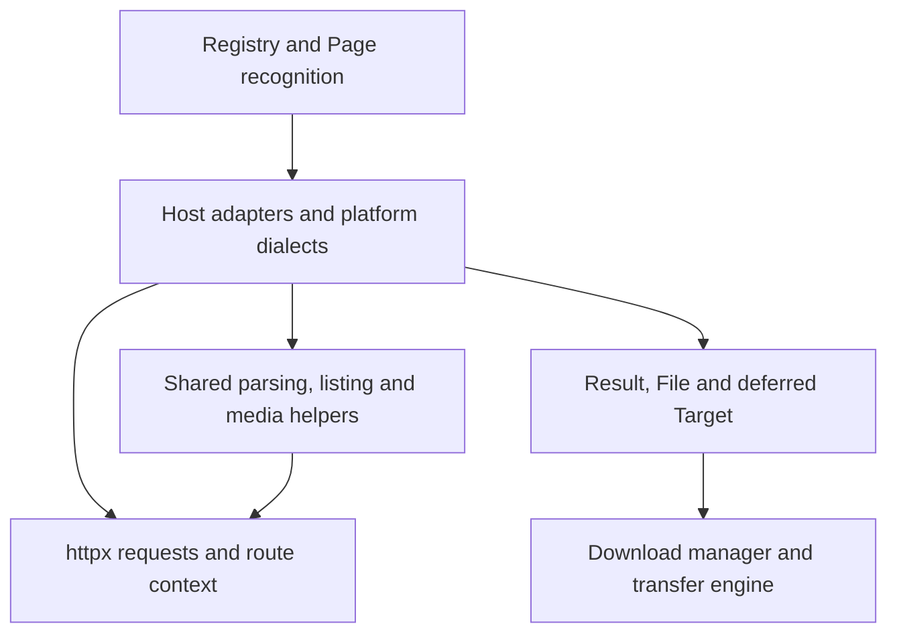

# Scraper consolidation and code reuse plan

Investigation date: 2026-10-31. Baseline: `f36100d363eec07b20ce87f0fe53387fc329a464`.
Status: implemented; see [Implementation status](#implementation-status). The
investigation below describes the baseline as it was found.

## Recommendation

Build on the existing extractor engines and consolidate the contracts around
them: complete media descriptors, bounded document reads, cancellation and
listing outcomes, embedded-data parsing, and renewable credentials. These are
shared behaviors where an improvement reaches many scrapers. Several already
have observable inconsistencies that give the work a concrete acceptance test.

Keep the existing separation between page recognition, host-specific parsing,
and downloading. Broadcasters, authenticated file services and platform
dialects need their own policies even when they use the same helpers. Further
conversions to table rows should earn their place through a small pilot.

## Implementation status

| Increment | Outcome |
| --- | --- |
| A | `File.target` is the one File-to-Target conversion, used by generic refresh, eager attachment resolution and `hlsMedia.target`. Refresh keeps the key, audio and subtitles, and clears tracks a fresh playlist lacks. |
| B | `httpx.ReadBody` is the bounded reader for buffered responses, the registry probe, platform JSON probes, the canonical player probe, the challenge sniff and the generic media-page fetch. An incomplete probe sets `Page.Err`, is evicted and is never offered as a document. |
| C | `resolveOutcomes` is the ordered map for listings, seasons and source expansion, and both modes stop at cancellation. `readListing`, `noneResolved`, `expandSeries`, the walker cap exits and the album callers that finish by hand let caller cancellation outrank partial results. The notes on failed items beside successes are unchanged. |
| D | `rawText`, `linkedData` and `jsonAttr` decode script payloads and JSON attributes as written. The JSON-LD readers and two inline-script scanners use them, and the unchanged-gallery path shares one decode between recognition and extraction. A JSON-LD name with internal runs of whitespace now keeps them, which is the documented fix. |
| E | `renewable` holds Gofile's, RedGifs' and VRT MAX's tokens, with their lifetimes in `config/limits.go`. RTBF and ORF keep their own code, because their device id and site-read credentials do not fit without switches. |
| F | Rajce is a `shareSite` row, and a contract test covers every registered row. The JW Player readers stay separate: a shared candidate step would change first-source behaviour (see `extractors.md`). Registry and fediverse comments now describe page recognition. |

Private offline replay of the full corpus matched its baseline after
increments A and B. After all increments it differs on six pages read by the
generic fallback, whose link expansion always runs into the replay's per-URL
deadline. The baseline recorded the partial expansion collected by then as a
success; with increment C, the deadline outranks it. Production extraction
has no deadline of its own, so this is the intended cancellation fix, seen
through the harness. The private baseline was not rewritten to match it. The guides in `docs/agents/` describe the resulting contracts.

## Investigation and current structure

The review traced registry construction, page identification, player and share
engines, listing expansion, playlist construction and transfer-time refresh.
It inspected representative HTML albums, embedded players, API listings,
broadcasters, platform families and stateful file services, together with the
area guides and shared tests. This is a structural and behavioral review, not
a claim to have verified every host against its current live service.

At the baseline:

| Measure | Result | Method |
| --- | --- | --- |
| Registered extractor entries | 96, plus the `Direct` fallback | `TestRegistryNamesAreUsable` |
| Player descriptors | 17 | Production `playerSite` declarations |
| Share descriptors | 12 | Production `shareSite` declarations |
| Extractor production Go | 111 files, 41,729 lines | Tracked files; lines include comments and blanks |
| Extractor test Go | 113 files, 38,198 lines | Tracked files; excludes private live-test symlinks |

These counts describe size, not duplication. The package already contains
substantial reuse:

| Responsibility | Existing implementation | Assessment |
| --- | --- | --- |
| Dispatch and result normalization | [Registry](../backend/internal/extractor/extractor.go), [Page](../backend/internal/extractor/page.go), [platform probes](../backend/internal/extractor/platform.go) | Shared already. Preserve content-based recognition and ordered dispatch. |
| Embedded video players | [Player](../backend/internal/extractor/players.go), [player rows](../backend/internal/extractor/playersites.go), host-specific readers | A strong engine boundary: candidates, selection, playlists, deferred signing and optional listings. |
| File/album page adapters | [Share](../backend/internal/extractor/shares.go) | Removes repeated registration and recognition plumbing while retaining each parser. |
| Platform implementations | [Booru](../backend/internal/extractor/booru.go), [Fediverse](../backend/internal/extractor/fediverse.go), [PeerTube](../backend/internal/extractor/peertube.go), [Chevereto](../backend/internal/extractor/chevereto.go), [MediaWiki](../backend/internal/extractor/mediawiki.go) | Software dialects already cover multiple installations. Adding domain alias lists would work against this architecture. |
| Listings and nested folders | [walkPages](../backend/internal/extractor/pages.go), [walkListing](../backend/internal/extractor/listing.go), [walkTree](../backend/internal/extractor/tree.go), [source expansion](../backend/internal/extractor/sources.go) | Reuse the walkers. Their caps, ordering and completion rules are part of the product behavior. |
| Concurrent item expansion | [resolveOutcomes / resolveFiles](../backend/internal/extractor/resolve.go), [FanOut](../backend/internal/extractor/fanout.go), [broadcast helpers](../backend/internal/extractor/broadcast.go) | Shared scheduling exists, but cancellation and outcome handling still differ between wrappers. |
| Media and external tools | [HLS](../backend/internal/extractor/hls.go), [renditions](../backend/internal/extractor/renditions.go), [handoffs](../backend/internal/extractor/handoffs.go) | Native playlists and external downloads have distinct contracts worth keeping. |
| HTTP behavior | [httpx.Client](../backend/internal/httpx/client.go) | Retries, routing, challenge handling and response handling already have an owner. Scraper helpers should use it. |

The extraction flow uses these boundaries:

The arrows above describe the extraction flow. Package dependencies still
follow [AGENTS.md](../AGENTS.md): the extractor must not import the downloader
or own proxy leases, transfer scheduling, or UI state.

## Priorities

| Order | Work | Benefit | Change risk |
| --- | --- | --- | --- |
| 1 | Complete and centralize media conversions | Prevent lost audio/subtitles during generic refresh | Moderate: transfer descriptors |
| 2 | Share bounded document reading | Prevent truncated responses being reused as complete pages | Moderate: recognition and request behavior |
| 3 | Consolidate ordered outcomes and cancellation | Consistent cancellation across albums, seasons and source expansion | Moderate: many callers |
| 4 | Reuse raw embedded-data parsing and the existing Page tree | Preserve metadata and reduce repeated parsing | Low to moderate: parser acceptance and naming |
| 5 | Share renewable credential storage | Avoid repeated renewal and inconsistent cache lifetimes | Higher: concurrency and authentication |
| 6 | Pilot additional descriptor and player-parser reuse | Reduce remaining adapter boilerplate where the contracts match | Bounded if migrated one adapter at a time |

Items 1–3 are correctness work at shared boundaries. Items 4–6 should follow
the regression coverage established there. No throughput or CPU improvement
is claimed without measurements.

## 1. Complete media conversions

**Evidence.** [refreshFile](../backend/internal/extractor/hooks.go#L62)
manually turns a refreshed `File` into a `Target`. Its branch for a file
without `Resolve` copies segments and their key but omits `Audio` and
`Subtitles`. By comparison, `Target.file`, `hlsMedia.file` and
`hlsMedia.target` carry those fields. The
[downloader's resolveTarget](../backend/internal/download/worker.go#L967)
replaces audio and subtitles whenever the target contains segments, including
clearing old tracks when the new target has none.

A synthetic helper-level check confirmed that a refreshed file containing
both track kinds produces a target containing neither. The downstream
consequence follows from `resolveTarget`; no real transfer was performed.

**Plan.**

1. Add a regression for generic refresh of a playlist containing an encryption
   key, audio and subtitles, then fix the conversion in the same commit.
2. Establish one explicit conversion for the media value fields shared by
   `File` and `Target`. Use it in generic refresh and the direct-file branch
   of [cumPostLoader.resolve](../backend/internal/extractor/cum.go#L288),
   which also constructs a target from an existing file. Keep HLS constructors
   aligned with that contract.
3. Preserve the current semantics: approximate sizes become unknown on
   refresh; a segment-only file supplies a usable target URL; an existing
   resolver is invoked; external downloads remain outside native refresh.
4. Keep `Pace`, `Cipher`, `Check`, rejection hooks, directory names and resolver
   lifetimes on their existing owners. `Target.Discard` belongs to a newly
   resolved address-bound link. A field-copy helper must not pretend these
   control fields are interchangeable.

**Acceptance.** A synthetic refresh through the registry and downloader
retains the new key and all new tracks, clears tracks when a fresh playlist
actually has none, and preserves existing file matching and naming behavior.
The tests should exercise values and downstream behavior, not just inspect
struct field names.

## 2. Share bounded document reading

**Evidence.** [probePage](../backend/internal/extractor/page.go#L191) reads
through `LimitReader(MaxResponseBytes)`, while
[responseBytes](../backend/internal/httpx/client.go#L466), `platformJSON` and
the player's canonical-page probe read up to the limit plus one and reject
oversized documents. `probePage` also only records a body-read error when no
bytes were obtained. `Page.Document` and `fetchDocument` can therefore treat
a truncated probe as a reusable document.

A synthetic server returning `MaxResponseBytes + 64` bytes confirmed that the
probe caches and exposes the prefix as successful while `Client.Fetch`
rejects the same response. This is a difference between two paths to the
same scraper input.

**Plan.**

1. Factor the bounded read and completeness check into one small helper,
   owned by `httpx`, or by `util` if it only accepts a reader and a limit.
   Keep the configured limit in `config/limits.go`.
2. Apply it to normal buffered responses, registry probes, platform JSON
   probes and canonical player probes. An oversized or interrupted response
   must not become a successful reusable `Page`.
3. Preserve each caller's request policy. Registry page reads use normal
   HTTP retries; optional platform/canonical identification uses its bounded
   one-shot policy. Status interpretation, accepted content types, challenge
   capture and error wording remain with their current callers.
4. Keep media probes from reading binary bodies. Replacing every probe with
   an unconditional `Fetch` would change that behavior.
5. Verify that a failed probe is evicted and a subsequent complete request
   can succeed. Preserve the final redirect URL and the existing route key.

**Acceptance.** Test limit-minus-one, exact-limit, limit-plus-one, interrupted
bodies, binary responses and redirected documents. Assert request counts,
cache reuse/eviction and `DoOnce` behavior on 429. Use the existing
[recognition tests](../backend/internal/extractor/recognise_test.go),
[platform tests](../backend/internal/extractor/platform_test.go),
[player probe tests](../backend/internal/extractor/playerprobe_test.go) and
[HTTP tests](../backend/internal/httpx/client_test.go).

Private corpus recordings can explicitly contain truncated textual responses;
review those outcomes when this behavior changes. Do not silently rewrite
the private baseline to preserve successful extraction from incomplete data.

## 3. Consolidate ordered outcomes and cancellation

**Evidence.** The package has several layers around the same operation:
`FanOut`, `resolveOutcomes`, `resolveFiles`, `readListing`, `resolveEach`,
`readSeasons`, `expandSeries` and `noneResolved`.

There are useful domain differences, but repeated control flow has diverged:

- `resolveOutcomes(inTurn=true)` invokes each callback without checking
  cancellation between items. `readSeasons` has its own indexed outcome type
  and serial/parallel branches, and its serial branch does check cancellation.
- `readListing` only returns `ctx.Err()` when no files succeeded.
  `noneResolved` similarly returns success first when files exist.
- `listSeries` checks cancellation after expansion even when files succeeded.

Synthetic checks confirmed both the sequential callback behavior and
`readListing` returning files with a nil error after its resolver cancels the
context. These are helper-level findings; the review does not claim every
calling job exposes the same result to users.

**Plan.**

1. Make ordered, bounded mapping with retained item errors the common
   primitive in `resolve.go`. Preserve the item/index, successful value and
   error, with the same cancellation behavior in serial and concurrent modes.
2. Have `readSeasons` use that primitive. Preserve its policy for the first
   season's error, season ordering, `more`, and unreadable-season notes.
   Broadcaster-specific refusal handling remains a wrapper over outcomes.
3. Give result-finalization helpers one rule: caller cancellation takes
   precedence over a partially collected success. Apply it to `readListing`,
   `noneResolved`, `listSeries` and their direct equivalents in album and
   source-expansion callers. Check early cap returns in `walkPages` and
   `walkTree` as part of the same contract audit.
4. Keep `FanOut` as a compatibility adapter where appropriate. For example,
   [Autoindex.readAll](../backend/internal/extractor/autoindex.go#L264)
   deliberately fills nodes and collects failure flags; it does not need a
   broadcaster's refusal model.
5. Preserve existing successful-result notes during the control-flow
   refactor. Separately decide whether ordinary failed items beside successes
   should be counted in notes: today `sortOutcomes` retains the first failure,
   but `readListing` reports only the refusal summary on success. Treat any
   change there as an explicit user-visible improvement.

**Acceptance.** Tests cover cancellation before work, during a callback and
after a successful callback; no later serial callback starts; active
concurrent work settles; output order remains stable; concurrency stays
bounded; all-failed and mixed outcomes retain their reasons. Caps continue
to count files, sources and episode request budgets according to the caller.
Keep the existing folder naming and partial-note tests.

## 4. Reuse embedded-data parsing and parsed pages

**Evidence.** `Page.HTML` and `fetchRoot` already allow recognition and
extraction to share one DOM. Some readers still take a body string and parse
it again. For example, [Celeb.Recognise and Celeb.Extract](../backend/internal/extractor/celeb.go)
both call `celebPageData`, which parses HTML and decodes the same `data-page`
when the canonical gallery URL is unchanged.

There is also a semantic mismatch between
[scriptTexts](../backend/internal/extractor/html.go#L244), which preserves
script contents, and `textOf`, which collapses whitespace for display text.
[mediaPageLinkedData](../backend/internal/extractor/mediapage.go#L460) and
[epornerLinkedName](../backend/internal/extractor/eporner.go#L195) decode
JSON-LD through `textOf(script)`. A synthetic JSON-LD name containing two
spaces was returned with one. The [Rajce parser](../backend/internal/extractor/rajce.go#L102)
already explains and handles this distinction correctly.

**Plan.**

1. Extract a raw node-text primitive from `scriptTexts`. Reuse it for JSON-LD
   and other script payloads; reserve `textOf` for rendered display text.
2. Add small helpers for JSON script islands by ID/type and JSON attributes
   where multiple consumers share the same mechanics. Start with JSON-LD,
   `nextData` and `data-page`; keep schemas, required fields and ownership
   checks in each host reader.
3. Let those readers accept the existing parsed root/Page internally.
   Preserve pure parsing entry points for synthetic fixtures. Use `memo`
   only for immutable decoding results shared within the same `Page`.
4. Start with the unchanged-gallery path in `celeb.go` and the common
   JSON-LD readers. A canonical URL change must still read its own page.
   Adopt the helper in other adapters as they are touched.
5. Keep JSON and JavaScript object literals distinct. `scanObject`,
   `unpackJS`, and a `json.Decoder` reading one value from an assignment
   solve different problems. This work does not require a JavaScript runtime
   or a general selector/configuration language.

**Acceptance.** Preserve whitespace and Unicode inside JSON strings; handle
attribute quoting and HTML entity decoding correctly; retain JSON-LD object,
array and `@graph` handling; ignore unrelated recommendations and image
objects. Characterize titles before changing whitespace behavior, because
names determine paths on disk. Add request-count checks and focused parsing
benchmarks before claiming performance savings.

Page and DOM data shared by concurrent callers should be treated as
immutable. Clone URL or decoded values before modifying them. Do not widen
memoization across routes, credentials or representations: `pageJSON` is
currently keyed by endpoint inside one page, not a general authenticated
response cache.

## 5. Share renewable credential storage

**Evidence.** [Gofile.ensureToken](../backend/internal/extractor/gofile.go#L308)
and [RedGifs.ensureToken](../backend/internal/extractor/redgifs.go#L162)
repeat mutex-protected token storage, age checks, fetching, validation and a
`force` flag. Multiple requests refused with the old token can each force a
new token after acquiring the lock. This is a concurrency risk inferred from
the code; it was not stress-tested during this review.

[RTBF.anonymous](../backend/internal/extractor/rtbf.go#L313) already has a
better invalidation rule: renew only if the stored token is still the one
the caller found stale. [VRTMax.playerToken](../backend/internal/extractor/vrtmax.go#L446)
adds provider-supplied expiry and a safety margin.
[ORF.credentials](../backend/internal/extractor/orf.go#L340) stores an API
base and authorization together, with a different refresh path.

**Plan.**

1. Introduce a small private renewable-value helper, initially for Gofile and
   RedGifs. It should cache only successful validated values, support expiry,
   and coalesce a refresh for callers observing the same stale generation.
2. Make waiting for an in-progress refresh cancelable. Define ownership of
   the fetching context explicitly; one canceled waiter must not invalidate
   an already successful cache entry, and a failed refresh must be retryable.
3. Keep endpoint construction, credential decoding, refusal classification,
   device IDs and retry policy in each extractor. A 401, a specific JSON
   status and a geo/DRM refusal must not become the same retry condition.
4. Migrate RTBF/VRTMax/ORF only when the helper fits their existing behavior
   without a growing collection of switches. Keep TTLs and margins in
   `config/limits.go`, as the repository requires.
5. Keep page memoization, platform `hostMemo`, per-post metadata loaders and
   address-bound download tickets separate. They have different identities,
   lifetimes and failure semantics. In particular, Keep2Share's per-route
   ticket cache and `Target.Discard` are not process-wide bearer tokens.

**Acceptance.** Under the race detector, concurrent users of an expired
generation cause one successful refresh; an older refusal cannot invalidate
the replacement; failed loads remain retryable; canceled waiters stop;
expiry is deterministic under a test clock. Existing authentication and
route-isolation tests continue to pass. Compare token request counts before
and after using synthetic servers.

## 6. Pilot further scraper consolidation

### Adapter rows

[Rajce](../backend/internal/extractor/rajce.go) is a reasonable small pilot
for `shareSite`: it has a client, one discoverable form, page-only recognition
and no extractor-wide token state. Keep its parsing functions, filenames,
redirect referer and album-specific unavailable-item notes. Keep the
constructor and its registry position. Proceed only if the resulting adapter
is easier to maintain and eliminates plumbing without adding engine flags.

Do not automatically migrate every stateless type. There is a concrete
contract mismatch for [Erome](../backend/internal/extractor/erome.go):
`Shape` deliberately admits album links, while `Recognise` can also accept
profile pages. PornPics similarly recognizes some listings with no safe
discoverable URL shape. `Share` currently builds `Shape` from all its forms
and only recognizes a matching form. A naive conversion would either lose
these pages or broaden link harvesting to navigation.

If several migrations justify it, model discoverability and page recognition
as separate descriptor concerns, preserving the registry's existing
`Shape`/`Recognise` distinction. Otherwise leave those adapters as types.
API-probing recognition, submitted-versus-final URL handling and persistent
state are further reasons to retain dedicated types.

Extend descriptor contract coverage using the precedent of
`TestPlayerSitesAreCompleteAndRegistered` and the existing Share form tests.
Check required callbacks, discoverable forms, redirect-only forms and stable
registration order. Avoid another manually maintained inventory: the
registry and `make hosts` already own it.

### Shared player source parsing

There is a narrower opportunity around JW Player:
[jwSource](../backend/internal/extractor/jsdecode.go#L32) reads the first
supported link from a JavaScript source list, while
[jwPlayerBest](../backend/internal/extractor/mediapage.go#L338) interprets a
JSON feed, separates video/audio and ranks normalized candidates.

Retain separate JS and JSON readers, then evaluate a common source-to-candidate
normalization step for type, relative URL, quality and exact size. Keep the
source-list boundary that excludes thumbnail sprites. Reuse `bestCandidate`
where selection policies agree; do not silently change first-source behavior
or broadcaster-specific quality preferences as a side effect of refactoring.
Pilot only after fixtures establish the intended ordering and exclusions.

## Boundaries to preserve

| Boundary | Why it matters |
| --- | --- |
| Recognition by content; `Shape` is only a discovery hint | Domains move, platforms have unknown installations, and broad navigation must not trigger extraction. |
| Registry order and strict nested extraction | Several URL forms overlap. A change in priority can route a valid link to a different parser or save a navigation page. |
| Deferred versus eager resolution | Some signatures expire in a queue; some player reads consume a token; some album listings already provide everything needed. |
| Route-local sessions and request identity | Cookies, final referers, authorization, User-Agent and egress address can all affect what a page or link means. |
| HTTP retry versus metadata retry versus transfer retry | These have different budgets and ownership. Existing `withExtractRetries` addresses successful but unusable metadata responses. |
| Host wait/refusal types and `Pace` | A route refusal, an unavailable file and a timed wait lead to different queue actions. |
| Stable title, filename and folder semantics | Cosmetic normalization can make a later run download the same content into a new directory. Notes stay out of titles. |
| Broadcaster and platform dialect policies | DRM, geo restrictions, rendition ranking, season order, language tracks and pagination schemas differ. Reuse mechanics around them. |
| Existing external handoffs | Replacing yt-dlp handoffs with native implementations is separate maintenance work, not a consolidation win by itself. |

Keep new helpers private to `extractor` until another package has a concrete
need. Dependency-free utilities belong in `util`; HTTP mechanics belong in
`httpx`. Splitting every host into a subpackage now would require exporting
many internal helpers and complicate the current test seams. Revisit package
splitting after the contracts have settled, if it solves a measured problem.

## Delivery sequence

Each row below is a reviewable increment on the repository's normal `main`
workflow. Commit a regression with its fix so `main` stays green. Estimates
are rough engineering days including tests and guide updates, not measured
delivery commitments.

| Increment | Scope and files | Dependency | Estimate / exit condition |
| --- | --- | --- | --- |
| A | Media conversion: `extractor.go`, `hooks.go`, `hls.go`, `cum.go`; focused extractor/downloader tests | None | 1–2 days; refreshed playlist fields survive end to end |
| B | Bounded reads: `httpx/client.go`, `page.go`, `platform.go`, `players.go` | None | 1–2 days; incomplete documents are never reused as complete |
| C | Outcomes: `resolve.go`, `broadcast.go`, affected album/source callers and walker exits | None; preserve A/B tests | 2–3 days; one cancellation contract and unchanged successful listing order/caps |
| D | Raw scripts and Page reuse: `html.go`, JSON-LD readers, `broadcast.go`, `celeb.go` | B | 2–3 days; metadata preserved and repeated parsing reduced in the pilot |
| E | Renewable values and two initial token users | Contract tests from A–C | 2–4 days; one refresh per stale generation under concurrency |
| F | Rajce descriptor pilot; separately evaluate JW candidate normalization | D and stable contract suite | 1–3 days per accepted pilot; smaller adapters with preserved dispatch and output |

Stop a pilot if removing a small amount of wrapper code requires new special
cases throughout a shared engine. The first five increments have value even
if no additional extractor becomes a row.

Update the matching guides with each implementation: `docs/agents/extractors.md`,
`http.md`, `media.md`, the affected host notes, and transfer/proxy guides when
their contracts change. Correct adjacent comments that still describe host
dispatch, such as parts of `NewRegistry` and the introductory comparison in
`fediverse.go`; the implementation now recognizes pages.

## Validation and completion criteria

Use the existing test helpers and private replay infrastructure. There is no
need for a second scraper harness or public copies of fetched pages.

1. **Synthetic contract tests:** retain negative recognition fixtures on an
   unrelated host, canonical redirects, request counts, cancellation, caps,
   output ordering, route isolation and the media conversion regressions.
   Shared tests cover mechanics; host fixtures retain schema and policy cases.
2. **Private offline replay:** from the sibling `hl-priv` checkout run
   `./support/audit-corpus.sh ../HeapLeach`. It uses the actual registry and
   extractors and fails on missing recordings. Use its documented `ONLY`
   filter for an adapter migration, then the full corpus for shared changes.
   Compare recognition, outcome, file count and deferred/external behavior;
   retain negative cases. Review filenames, directories, notes and request
   counts with focused fixtures where the existing corpus baseline does not
   compare them.
3. **Keep replay limits explicit:** it does not call file resolvers or run
   transfers. Its anonymous request key omits cookies and authorization, so
   it cannot validate credential/session isolation. Test those with synthetic
   servers. Handle recorded truncated responses explicitly after increment B.
4. **Go verification:** from `backend/`, run
   `go test ./internal/extractor ./internal/httpx ./internal/download -race`
   for the shared changes, then the repository's `make check` before delivery.
   Run `make hosts` if descriptor text changes and ensure `make hosts-check`
   remains clean. Use the private live tests required by the extractor guide
   for implementation changes, keeping transfer checks separate from replay.
5. **No corpus leakage:** all real URLs, filenames, recorded responses and
   live tests stay in `hl-priv`. Public fixtures remain synthetic. Run the
   repository's content-link check before committing.

Completion means the confirmed inconsistencies have regression coverage and
are fixed; the shared helpers have at least their named adopters; extraction
selection and outputs are unchanged except for documented fixes; parser and
credential request counts do not regress; and the current guides explain
the resulting contracts. A lower file count alone is not a success measure.

## Verification performed for this plan

- `go test ./internal/extractor ./internal/httpx -race` passed. The extractor
  package completed in 43.020 seconds; the HTTP package result was cached.
- `go test ./internal/extractor -run '^TestRegistryNamesAreUsable$' -v`
  passed and reported 96 registered entries.
- Five temporary Go-overlay checks ran with `-race -count=1` and confirmed
  the observations below. They asserted the current behavior for investigation;
  they are not permanent regression tests and made no production-code changes.

| Synthetic reproduction | Observed behavior | Desired regression assertion |
| --- | --- | --- |
| Refresh a `File` with segments, one audio track and one subtitle track through `refreshFile`, without a custom resolver | Returned target has no audio or subtitles | Both track kinds survive |
| Cancel inside the sole successful callback passed to `readListing` | Returns one file and a nil error | Returns caller cancellation |
| Call serial `resolveOutcomes` with an already canceled context and three inputs | Invokes all three callbacks | Invokes none |
| Serve an HTML body of `MaxResponseBytes + 64` bytes | Page cache retains a successful truncated prefix; normal `Fetch` rejects it | Both paths reject an incomplete reusable document |
| Parse a JSON-LD `VideoObject` named `Synthetic  Clip` through `epornerLinkedName` | Internal double space becomes one | Payload decoding preserves the original value |

No live host requests, media transfers or full private corpus replay were
performed for this documentation-only review. Token-renewal concurrency and
parser performance recommendations remain code-based proposals to validate
during implementation.

Structural discovery used the codebase-memory graph generated at
`2026-10-31T12:02:37Z`, followed by source reads and targeted call traces.
Coverage checks covered 270 tracked paths across the extractor/HTTP code,
supporting documentation and selected boundary files. Twelve extractor files
had reported partial parsing at `new(expression)` return statements; those
ranges were read directly. Private live-test symlinks are outside the index.
Receiver methods can share graph names, so graph degrees were not treated as
exact caller counts or proof of exhaustive impact. The concrete findings
above rely on source and synthetic execution.
