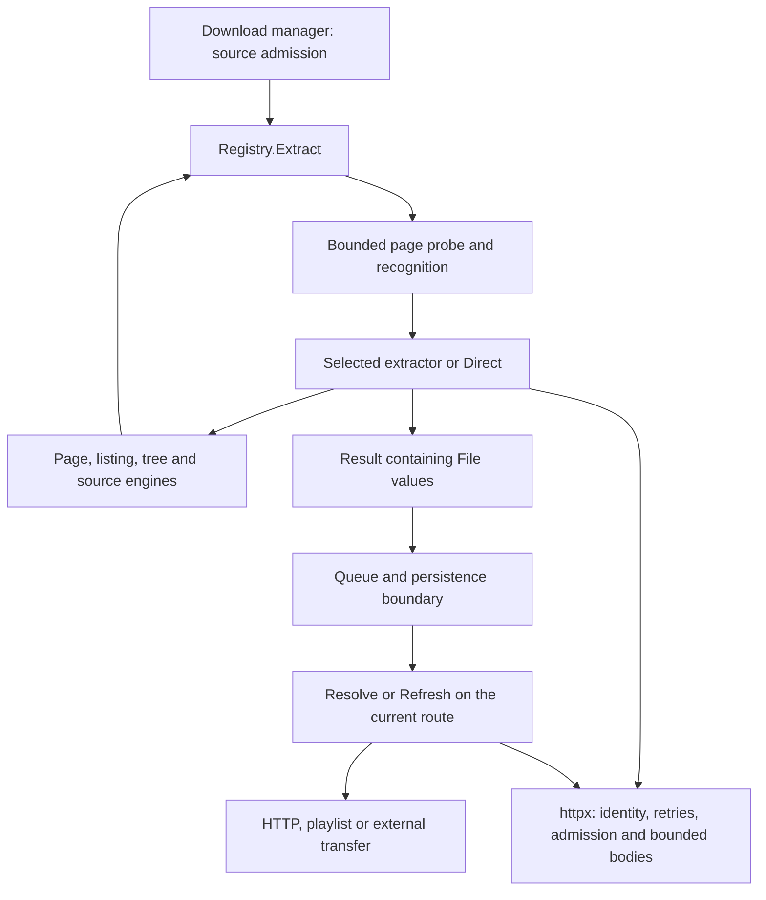

# Scraper and supporting-code consolidation plan

Status: proposed implementation plan; no scraper migration is implemented by this document.

Baseline: branch `consolidation-adoption`, commit
`efa21c7197cd20daf26ac3355297c52e7ed8b41b`, inspected on 2026-10-31.
This plan was built from the current source, tests and area guides without
consulting the previous version of this file.

The objective is to give each repeated operation one implementation and each
behavioral decision one explicit owner. Extend the shared machinery already in
use, migrate callers in small groups, and remove the superseded paths. Keep
site protocols, media selection, naming and state lifetimes visible where they
differ. A smaller file count is not an objective by itself.

**Hard constraint: no breaking behavior.** Preserve supported inputs, selected
extractors, outputs, names, errors, limits, request semantics and deferred
resolution behavior. No work package may trade compatibility for less code.
If a shared abstraction cannot preserve a caller's contract, retain that caller's
existing implementation or its explicit policy adapter. An unexplained behavior
difference blocks the migration; changing expected results does not resolve it.
Fixing demonstrated existing bugs or regressions is allowed under section 3's
bug-fix gate. That permits restoring intended behavior, not changing requirements
or breaking working cases.

## Contents

1. [Scope, evidence and success measures](#1-scope-evidence-and-success-measures)
2. [Current architecture and consolidation already present](#2-current-architecture-and-consolidation-already-present)
3. [Compatibility requirements](#3-compatibility-requirements)
4. [Target ownership and source layout](#4-target-ownership-and-source-layout)
5. [Prioritized work packages](#5-prioritized-work-packages)
6. [Scraper-family migration inventory](#6-scraper-family-migration-inventory)
7. [Supporting-code migration inventory](#7-supporting-code-migration-inventory)
8. [Test and replay strategy](#8-test-and-replay-strategy)
9. [Implementation sequence and dependencies](#9-implementation-sequence-and-dependencies)
10. [Performance and resource budgets](#10-performance-and-resource-budgets)
11. [Risks, rollback and deferred decisions](#11-risks-rollback-and-deferred-decisions)
12. [Completion checklist](#12-completion-checklist)

## 1. Scope, evidence and success measures

### Scope

The primary scope is `backend/internal/extractor`: registration, recognition,
page acquisition, parsing, pagination, collection expansion, media discovery,
signing, credentials and the `File`/`Target` contract. Supporting scope covers:

- `internal/httpx`: request construction, representation identity, bounded
  reads, retries, challenge capture, request admission and route contexts.
- `internal/config` and `internal/util`: tunable defaults, common headers,
  naming and dependency-free operations used by extractors.
- `internal/download`: the boundary that consumes extracted files, invokes
  resolvers, applies refreshed metadata, persists jobs and recovers routes.
- `internal/tools` and `internal/captcha`: process and inference lifecycles
  used by scraping, with their existing ownership retained.
- `internal/proxy`: the adapter to the lease library, only where extraction
  and resolution depend on its contracts.
- Registry inventory generation, public synthetic tests, private recorded
  parsing checks, and the corresponding contributor and user documentation.

UI, API and persistence changes are outside this consolidation. Preserve their
existing payloads, formats and behavior.

This is not a project to add sites, remove supported sites, implement DASH or
DRM handling, replace yt-dlp, add a browser automation platform, change proxy
selection, retune concurrency, or redesign download scheduling. Those changes
would obscure whether a consolidation preserved behavior.

### Evidence and limits of the audit

At the baseline:

| Measure | Observed value | Interpretation |
| --- | --- | --- |
| Extractor production Go files | 112 | Top-level `.go` files excluding `_test.go` |
| Extractor production lines | 42,564 | Includes comments and blank lines; not a complexity score |
| Extractor ordinary test files | 126 | Excludes private `*live_test.go` symlinks |
| Generated catalogue entries | 97 | `go run ./cmd/hostlist -count`; includes `direct` |
| Registered Player rows | 17 | One engine, several page/API/handshake readers |
| Share rows | 13 | Includes Rajce; parsers can remain in their own files |
| Handoff rows | 7 | yt-dlp-backed families |
| Pointer rows | 2 | Resolve another page through the registry before external fallback |

Structural discovery used the codebase graph, with path coverage checks and
source verification. The graph generation was `2026-10-31T18:18:55Z`. Reported
partial ranges in the relevant Go files and Makefile were read directly.
Private live-test symlinks and binary image fixtures are not covered by that
graph. Static call relationships are useful discovery evidence, not proof that
an indirect callback has no other consumer or that every protocol path was
executed. Candidate migrations below therefore include explicit admission gates.

The following baseline command passed:

```sh
# From backend/
go test ./internal/extractor ./internal/httpx ./internal/download \
  ./internal/tools ./internal/captcha ./internal/util ./internal/config
```

This was the ordinary package suite, without `-race` or live tags. It is not
proof of native OCR model execution, current live-site availability, a full
`make check`, or private corpus replay. No live content was fetched for this
planning audit. Implementation validation is specified in section 8.

### Success measures

A work package succeeds when its callers use one operation with a documented
contract, the old implementation is removed, and the relevant observable
behavior and resource bounds still match. Record these measures per package:

1. Number of independent production implementations of the targeted operation.
   Count wrappers separately from implementations; a wrapper preserving a
   useful policy is not duplication.
2. Migrated callers and explicit exceptions, with a reason and a regression
   test for each exception. No unclassified caller remains in the chosen scope.
3. Registry selection, ordered output, names, directories, sizes, notes,
   refusal types and deferred capabilities before and after.
4. Requests and helper invocations per operation, maximum requests in flight,
   and unnecessary HTML parses or payload decodes removed.
5. Benchmark time and allocations for changed shared paths, with the fixture
   and comparison conditions stated.
6. Deleted obsolete helpers, duplicate metadata, compatibility scaffolding and
   tests that only exercised removed implementations.

Do not set an arbitrary line-reduction percentage. The plan should still reject
a short generic abstraction that makes site policy harder to understand.

## 2. Current architecture and consolidation already present

### Runtime flow



The recursive edge is important: sources can produce more sources. Per-map
fan-out and top-level request admission solve different problems. The manager
also limits how many source jobs are resolving at once.

### Existing shared implementations to retain

Paths in the following table are relative to `backend/internal/extractor/`.

| Concern | Current owner | Existing adopters or consumers | Consolidation implication |
| --- | --- | --- | --- |
| Names, advertised shapes and inventory descriptions | `about` in `extractor.go`; `catalogue.go` | Dedicated extractors and all row engines | Do not recreate a metadata interface hierarchy |
| Ordered dispatch and result normalization | `Registry` in `extractor.go` | Every submitted or followed source | Preserve order and top-level versus nested behavior |
| Probe reuse and request identity | `page.go`, `platform.go` | HTML readers, canonical player probes, platform APIs | Consolidate acquisition behind these contracts |
| Page-only player parsing | `players.go`, `playersites.go` | 17 Player rows | Extend `parse`/`read` adoption only where the contract fits |
| Stateless share dispatch | `shares.go` | 13 Share rows | Many file hosts are already converted |
| External handoffs and pointer pages | `handoffs.go`, `pointers.go` | Seven handoffs, two pointers | Keep them distinct from native media resolution |
| Paged traversal | `pages.go`; HTML adapter in `listing.go` | Albums, searches, timelines, broadcasters | `walkEnd` already represents termination structurally |
| Nested folder traversal | `tree.go` | Gofile, MediaFire, Pixeldrain, Filester | Reuse it for compatible depth-first folder protocols |
| Ordered outcomes | `resolve.go` over `fanout.go` | Listings, seasons, series and source expansion | Improve the scheduler API without inventing another pool |
| Sources producing other sources | `sources.go` | Links, indexes, WordPress, gallery expansion | Preserve source-atomic file caps and directory policy |
| Broadcaster orchestration | `broadcast.go` | Episode/season expansion, refusals, media builders | APIs and media post-processing remain host-specific |
| Rendition selection | `renditions.go` | Players and generic media readers | A shared comparator exists; different selection policies remain explicit |
| HLS interpretation | `hls.go` | Players, broadcasters, generic pages, direct HLS | Keep one manifest implementation |
| Media conversion | `File.target`, `Target.file`, `hlsMedia.file/target` | Refresh paths and playlist callers | Carry every media field together |
| Renewable credentials | `renewable.go` | Gofile account, RedGifs token, VRT token | Do not conflate credentials with every other cache |
| Route-local waits | `routewaits.go` | Keep2Share and Mega | Preserve route identity and late invalidation semantics |
| Notes and refusal accounting | `notes.go`, `resolve.go`, `sources.go` | Collection finishers | Render text from state; do not infer state from text |
| Semantic retries | `retry.go` | Successful-but-incomplete responses and reload handshakes | Keep separate from HTTP and transfer retries |

Supporting code already centralizes important operations too:
`httpx.Client.send` is the common attempt loop; `httpx.ReadBody` detects
oversized complete-body reads; `tools.CommandContext` owns child processes;
`tools.Probe` bounds metadata output; and `httpx.Admission` bounds discovery
requests while their response bodies remain open.

The remaining work is concentrated in overlapping entry points, incomplete
adoption, duplicated registration bookkeeping, misplaced policy, and tests
that need to verify several layers together. It is not a fresh framework build.

## 3. Compatibility requirements

Treat these as acceptance criteria for every migration, including changes that
look mechanical. Compatibility is a release gate, not a preference or a target
percentage. All currently supported cases must remain supported. Untested cases
must be characterized before replacing their implementation; uncertainty does
not authorize a behavioral change.

The baseline includes failure paths, ordering, names, limits, timing of protocol
steps and restart behavior as well as successful extraction. Internal file
layout, helper names and an avoidable repeated DOM parse can change without
changing those contracts. Reducing a request count requires proof that the
removed request was redundant under the existing freshness and identity rules.

### Existing bug fixes without new regressions

Refactoring preserves existing behavior. A bug fix may change a defective case
to meet an existing requirement, but must preserve working behavior around it.
Use this gate for every proposed fix found during consolidation:

1. Name the existing requirement and its evidence: an area-guide invariant,
   established contract, regression against earlier working behavior, or a
   reproducible supported case. Mere inconsistency with another host is not
   proof of a bug.
2. Reproduce the defect in a focused synthetic test that fails on the current
   implementation. Keep live-derived evidence and recordings in `hl-priv`.
3. Describe the exact before/after behavior, including errors, request timing,
   filenames, limits and downloader actions where affected. The correction
   must not redefine a supported input, remove support or introduce a new policy.
4. Fix the defect in a separate commit from mechanical moves or broad adoption.
   If a shared-helper migration depends on the fix, land and verify the fix
   first, then consolidate against that corrected baseline.
5. Test adjacent working cases and producer/consumer boundaries, not only the
   failing input. Use private replay when real responses informed the fix.
6. Record the requirement, regression test and narrowly explained baseline
   difference. Update documentation to reflect the restored requirement;
   do not rewrite requirements or broad expected outputs to make a change pass.

Potential defects named below are investigation candidates, not confirmed bugs.
If a claimed fix cannot meet this gate, retain the existing behavior. The strict
equivalence requirements elsewhere apply to the refactor; only a verified fix's
specific defective case may differ. No unrelated regression is acceptable.

### Recognition and navigation

| Requirement | Consequence for the implementation |
| --- | --- |
| Recognition is based on page/API evidence, never domain membership | Keep host checks out of `Shape`, `Recognise` and row callbacks |
| `Shape` is a cheap discovery hint, not a promise or exhaustive recognition rule | A bare profile can be recognized without becoming a link-harvesting shape |
| First matching extractor wins | Do not sort registration by family or name |
| Submitted and redirected URLs have different roles | Preserve both; follow relative references from the appropriate final page |
| Origin probes are bounded and memoized | A broad unclaimed page must not trigger unlimited API attempts |
| Strict followed links cannot fall back to saving arbitrary HTML | Preserve `errUnrecognised` separately from transport failures |
| A failed strict probe is not evidence of navigation | Retain typed failures; unclaimed 404/410 navigation remains a special case |
| Positive platform recognition commits to that platform | Parser failure must not silently become a successful HTML download |
| Source cycles are path-local and depth-bounded | Do not use a process-wide visited set that merges independent jobs |

### Request, document and state ownership

- Shared `Page` bodies, trees, headers, URLs and memoized payloads are borrowed
  and immutable. Callers receive their own final URL; editing a DOM needs a
  private tree.
- Reuse is valid only for the request actually answered: URL, method, relevant
  headers, client identity, session and route. Preserve the existing explicit
  Referer exception and host-local exceptions such as Bandcamp's served page.
- A response prefix can identify a challenge or supply diagnostics; it cannot
  become a complete reusable document after a body-read failure.
- Body-only recognition and parsing must not acquire a DOM as a side effect of
  a convenience abstraction.
- Semantic retries use the attempt context and read afresh after the first
  attempt. Transfer-time resolution uses the current caller's context.
- Route, cookie jar, User-Agent, logger, progress callbacks and challenge
  capture survive context transformations that remove only the old page or
  discovery admission.
- Concurrent source jobs must not exchange protected-folder cookies, signed
  tickets or credentials whose scope is narrower than the shared extractor.
- Cancellation takes precedence over a partially collected successful result.

### Collections, counts and names

- Order is the site's order, independent of request completion order. An
  explicitly reversed listing, such as a chronological collection, keeps its
  existing reversal point relative to limits.
- Source count, file count, page count, folder depth and per-item request budget
  are distinct. Do not collapse them into a single integer called `limit` at
  the public boundary.
- A short API page does not imply the end. Respect totals, cursors, declared
  ends and each caller's accepted later-page statuses.
- Preserve empty, refused, failed, unrecognised, not-started, resolved and
  admitted-source accounting. A source resolved speculatively beyond the file
  cap did not fail.
- Source expansion admits whole sources until the file cap; only the first
  source larger than the cap can be cut. Retain the existing batching bound.
- Preserve `Result.Title`, file names, directories, title joining, extension
  spelling and duplicate-title policy. These affect repeat downloads and
  resume, not just presentation.
- Preserve the separation of partial-result notes from folder naming, including
  existing exceptions. Characterize and retain a legacy caller's different
  naming rule; RTP's capped-season title is one such case. Consistency alone
  does not justify renaming a user's folders.
- Preserve exact versus approximate sizes. Rewriting a URL to another encoding
  invalidates the original byte count; zero is not a substitute for unknown.

### Resolution and transfer

- Signed URLs are refreshed at the existing point: discovery, transfer start,
  retry or route recovery. Do not eagerly resolve a lazy album to simplify it.
- Refresh all playlist fields together: segments, key, audio and subtitles.
  A new segmented target with no tracks clears stale tracks in the downloader.
- Preserve `Resolve`, `Refresh`, `Check`, `Pace`, `Cipher`, `Reject`, `Refused`,
  `ProxyFallback` and `Discard` ownership when moving or rebuilding files.
- `WaitError`, `RefusedError`, `TransientError`, transport errors, challenges,
  password errors and item refusals keep their different queue meanings.
  Wrapping must preserve the error chain.
- Mirrors rotate only over equivalent sources the implementation already knows
  about. Consolidation cannot invent servers or switch encodings on resume.
- Keep byte transfer, decryption, muxing, persistent item state and proxy leases
  in the downloader and supporting packages. Extractors describe the work.
- Restore continues to reread a source before transferring unfinished items;
  do not persist closures, credentials or transient signed media as a shortcut.

## 4. Target ownership and source layout

### Package boundaries

Retain the existing dependency direction:

```text
config, util
  -> httpx, tools, captcha, logstore
    -> extractor, proxy
      -> download
        -> server, cli
```

The arrows show increasing layers, not permission for every package on a line
to import every other package. In particular, extraction must not import the
download manager or own its route pool. `hooks.go` provides the callback boundary
for recovery and progress without reversing that dependency.

Keep the extractor package intact during adoption. Moving hosts into Go
subpackages now would require exporting private parser and orchestration types,
introduce registry back-references, and mix a packaging change with behavioral
migration. Use files to clarify ownership first.

### Proposed file-level separation

These are proposed destinations, not files that already exist. Preserve existing
symbol names during moves so consumers and private replay overlays need fewer
simultaneous edits.

| Current concentration | Proposed separation | What remains together |
| --- | --- | --- |
| `extractor.go` | `contract.go` for `File`, `Target`, tracks, pacing and conversions; `errors.go` for queue-facing errors; `registry.go` for construction/dispatch; retain a small package-facing file if useful | `Result`, limits and normalization stay close to the registry contract |
| `page.go` | `page.go` for `Page` and its read-only index; `pagecache.go` for cache/coalescing; `document.go` for acquisition adapters and freshness; platform memo placement reviewed with `platform.go` | Request identity checks and their tests move as one unit |
| `broadcast.go` | Separate series orchestration from broadcaster media/title helpers if the work packages leave a clearer split | Do not create a general-purpose utilities file from unrelated helpers |
| `filehosts.go` | Move each share row and parser together if editing that host anyway | Shared Share operations remain in `shares.go`; Drive remains dedicated |
| `playersites.go` | Keep small rows readable; move larger row/parser units together when they are changed | Registration order stays in one registry assembly location |
| Large platform files | Optional route/schema/decoder splits within the same package | Platform identification, dialect policy and tests remain easy to find |

File moves follow behavior-preserving tests and should not be combined with
changes to parsing, limits, retry policy or naming. Do not move every file just
to enforce a symmetrical layout.

## 5. Prioritized work packages

Each package below names the observed opportunity, the implementation steps,
the boundaries to retain and its exit criteria. `Required` means part of the
core consolidation. `Conditional` means proceed only after the stated evidence
shows a useful common operation. A decision to retain an explicit exception
completes that investigation; it is not an unfinished migration.

### W0. Freeze observable contracts and build the migration ledger — required

**Evidence.** Registry, parser and downloader tests are substantial, but a shared
helper change can preserve a parser's files while changing registry selection,
request identity, resolver timing or disk names. The generated inventory counts
extractors, not protocol variants or lifecycle behavior.

**Work.**

1. Use the family inventory in section 6 as the initial ledger. For every changed
   caller, record entry point, shared engine, page/API reader, output type,
   source/file/request budgets, naming rule, state scope and required tests.
2. Capture expected synthetic outputs before editing each implementation.
   Compare ordered files, exact names/directories, size semantics, notes,
   selected media and presence of control callbacks. Do not compare function
   addresses or let the expected result call the helper being tested.
3. Add scripted resolver checks for selected families: initial extraction,
   first transfer, second attempt, a new route and cancellation. Check request
   sequence and media fields, not just that a callback is non-nil.
4. Record registry selection and bounded request counts for representative
   overlaps, unrelated-host fixtures, redirects and negative recognition.
5. Run the existing private offline corpus before a cross-family migration and
   store its revision/results privately. A missing recording is a gap, not
   permission to silently use the network.
6. Mark any demonstrated pre-existing bug separately from behavior that must
   be preserved. Apply section 3's gate before changing its expected result;
   record the corrected baseline before dependent consolidation.

**Deliverable.** A caller ledger, stable synthetic expectations, and a baseline
report naming commands, revisions, skips and known failures. Extend current test
files before adding a new harness. Do not generate a second supported-site list
that must be maintained by hand.

**Exit.** Every changed path has a behavioral oracle and a defined exception
policy; the baseline can distinguish a regression from a pre-existing failure.

### W1. Make registration and row validation have one source of truth — required

**Evidence.** `NewRegistry` owns the real order, while `playerSites` in
`playersites.go` repeats the Player subset in order for tests. Pointer wiring is
a second pass; other source-expanding constructors receive the registry
directly. `about`, `Share`, `Player`, `Pointer` and `Handoff` already provide the
metadata and engines.

**Work.**

1. Separate registry assembly from extraction execution as part of W11's
   file-only moves. Keep an explicit ordered list of ordinary constructors.
2. Allocate the registry early enough to wire source-expanding extractors
   consistently. Prefer passing the existing registry to constructors over
   building another registry or introducing a global singleton.
3. Remove duplicate production order bookkeeping. Tests can enumerate concrete
   rows from the assembled registry, but must retain independent expected
   labels/order and coverage of declared-but-unregistered rows. Deriving both
   actual and expected lists from the registry would prove nothing.
4. Keep validation at the row level: exactly one Player `parse` or `read`, valid
   listing callback combinations, `withheld` only with signing, `peek` without
   redundant eager signing, and Share forms with at least one recognizer.
5. Validate Pointer and Handoff rows similarly, without turning all four engines
   into one optional-callback struct. Confirm nil/unknown pointer lookup behavior
   remains controlled at construction.
6. Keep `Recognises` as the generated inventory's source. Verify catalogue
   membership and descriptions are unchanged. Run row validation in tests;
   do not introduce new production construction failures as incidental cleanup.

**Keep separate.** Link-discovery shape and full page recognition. Erome,
PornPics, Fapello and Bandzoogle illustrate why broad recognition cannot simply
become a Share form. Drive needs submitted-URL evidence as well as final-page
evidence. API-probing or stateful extractors do not become Share rows merely
because their constructors look similar.

**Tests.** `registry_test.go`, `precedence_test.go`, `recognise_test.go`,
`players_test.go`, `shares_test.go`, `handoffs_test.go`, `pointers_test.go`,
`catalogue_test.go` and `cmd/hostlist` tests.

**Exit.** One production registration order; every row registered and validated;
97 catalogue entries and existing order/selection behavior preserved at this
baseline. No dynamic plugin registry, reflection-based dispatch or priority sort.

### W2. Put document acquisition behind one implementation — required

**Evidence.** `fetchDocument`, `readDocument` and `fetchRoot` repeat the
`probedFor`/`Document` decision and fallback request in `page.go`. The lazy
`document` already exists, but its `tree()` returns only a node, while
`fetchRoot` also has a parse-error contract. Simply redirecting every caller
through it could change errors or force extra indexing.

**Work.**

1. Make one private acquisition path own: request-identity eligibility,
   complete-body reuse, final-URL ownership, fallback `GetPage` and optional
   access to the probe's already-built tree.
2. Preserve the existing public-to-package adapters and their signatures in the
   first change. `fetchDocument` returns a string/final URL; `fetchRoot` returns
   a tree/final URL/error; `readDocument` serves lazy readers.
3. Give the lazy document an explicit parse result, including the error, if
   needed to serve both adapters. Do not lose a parse error behind a nil tree.
4. Keep the parsed-tree reuse check cheap: do not call `Page.HTML` merely to
   build an index that recognition never needed.
5. Keep raw bodies and decoded payloads immutable. Do not add a process-wide DOM
   cache or retain every requested page beyond the existing cache budget.
6. Preserve freshness as an explicit context transformation, not a collection
   of reader-specific booleans. See W7 for the transfer boundary.

**Request matrix to pin.** Same URL and identity; timeout-copy client; another
cookie jar; changed Accept, User-Agent or credential; route change; redirect
alias; non-GET; missing or partial body; 200 versus other statuses; Referer-only
variation; cancellation while waiting on a shared page.

**Keep separate.** The registry probe, `platformJSON`, canonical player probe
and generic media sniff have distinct attempt/status/content-type policies.
They can share bounded reads without all becoming `GetPage` callers.

**Tests.** `page_test.go`, `identity_test.go`, `probebound_test.go`,
`docreuse_test.go`, `retry_test.go`, `playerpage_test.go`,
`playerprobe_test.go`, HTTP body/admission/session tests.

**Exit.** One eligibility/acquisition implementation; adapters preserve request
counts, errors, body-only cost and URL ownership. No new cross-session reuse.

### W3. Finish parsed-document adoption where it removes actual work — required audit, selective migrations

**Evidence.** Many readers already take parsed roots. Remaining concrete starting
points are Bandzoogle's `Extract -> bandzoogleParse -> parseHTML` after
DOM-based recognition, and KVS's browse/listing chain, where an already-parsed
listing is passed onward as `kvsListing.first` text and parsed again. Imgur's
`imgurMediaFrom` is another string-to-tree boundary worth evaluating separately
from its JavaScript payload reader.

**Work.**

1. Convert Bandzoogle's first-page reader to accept the root obtained through W2.
   Keep a string adapter for synthetic parser tests. Preserve its multiple
   offset continuations, track order, album detection and naming.
2. Carry an acquired document or root through KVS browse-to-listing handoff.
   Reuse it only for the page it represents; a canonical first-page request
   still needs its own answer. Keep raw text available for flashvars and
   reported-total parsing.
3. Inspect Imgur's media-only path for a root reader and retain its separate
   assignment/string decoder. Require a measurable removed parse before
   widening the change.
4. For each further candidate, write down whether recognition parsed HTML,
   extraction needs a tree, and both read the identical representation. Migrate
   only when those facts justify it.
5. Reuse `rawText`, `scriptTexts`, `linkedData` and `jsonAttr` for raw payload
   access when their exact semantics fit. Marker selection, schemas, required
   fields and error messages remain in the site's parser.
6. Memoize decoded payloads only when recognition and extraction genuinely
   decode the same payload, with a namespaced key and immutable returned value.

**Explicit exceptions.** WordPress removes nodes from a private tree; Bandcamp
has its own User-Agent/challenge decision; Niconico decodes metadata from error
bodies; password POST answers are different documents; feeds are XML; raw script
scanners should not acquire a DOM just for consistency.

**Tests.** Extend `TestProbedReadersReuseTheParsedDocument` and
`BenchmarkProbedReaders`; add relevant Bandzoogle/KVS/Imgur cases with redirects,
raw whitespace, failed canonicalization and malformed payloads. Compare paths
and notes as well as file counts.

**Exit.** Each migrated path parses a representation at most once when a parsed
probe exists, and the unparsed-probe path does no more work than before.

### W4. Consolidate complete metadata reads and request construction — required

**Evidence.** `httpx.ReadBody` already implements the whole-body bound with a
one-byte overflow check. `Niconico.grant` still uses
`io.ReadAll(io.LimitReader(..., config.MaxResponseBytes))`, and `feedCharset`
has another bounded-read path. Those are concrete audit targets. Other
`LimitReader` uses intentionally read a sample, drain a response, or enforce a
separate certificate bound and must not be swept into the same conversion.

**Work.**

1. Characterize the grant's complete-body read before adopting `httpx.ReadBody`.
   Preserve response cookies, headers, route identity and grant validation.
   The current limit-only read and the shared overflow-detecting read differ
   for oversized bodies; handle that through the bug-fix gate below, not as a
   mechanical replacement. Keep the body closed on every exit.
2. Characterize the size boundary before migration: exact limit, one byte over,
   a valid JSON prefix followed by more bytes, an underlying read failure, and
   a response whose declared length is misleading.
3. Check whether `feedCharset` can receive an input beyond the already-bounded
   feed buffer. Reuse the common complete-read contract where appropriate;
   document its encoding-expansion budget rather than accidentally measuring
   decoded runes as network bytes.
4. Inventory remaining direct `Do` callers by purpose: complete document,
   status-only probe, cookie/redirect-sensitive handshake, bounded sniff,
   discard/drain or streamed media. Give each an explicit approved primitive.
5. Prefer existing `GetJSON`, `PostJSON`, `Fetch` and `GetPage` when they retain
   the required response data. A grant needing `Set-Cookie` is a valid reason
   to use `NewRequest`/`Do` plus a bounded read.
6. Centralize header names and common values through `httpx/headers.go` as the
   repository requires. Keep per-host values and signing inputs with the host.
   Do not add decorative headers to endpoints that currently need none.
7. Preserve the distinction between a sampled `StatusError` and a whole JSON
   refusal needed by a host. Any new response helper must retain status,
   headers, original request identity and error wrapping.

**Bug-fix gate.** The existing HTTP guide requires complete buffered responses
to reject oversize/truncation; `ReadBody` documents the same rule. Demonstrate
whether the grant path violates it with a failing synthetic boundary test.
If confirmed, fixing that defect is allowed: retain successful in-limit grant
behavior and commit the correction separately from broad adoption. If it cannot
be established, keep the current reader. Likewise, a different typed refusal
can alter downloader retries; change it only to fix a demonstrated violation
of an existing error/retry requirement, with consumer tests. Uniformity alone
is not a reason to change it.

**Do not merge.** AIA's certificate-specific bound, browser challenge peeks,
`NewStatusError` samples, WeTransfer response draining, or download media
streams into the page-size limit. Preserve TLS verification and the existing
browser transport.

**Tests.** `httpx/body_test.go`, `client_test.go`, `admission_test.go`,
`niconico_test.go`, `feeds_test.go`, plus route/session tests for a changed
handshake.

**Exit.** No unclassified complete metadata reader in the migrated scope;
compatible reads share the same implementation; any confirmed truncation bug
has its own tested correction; status samples and streaming paths retain their
own behavior. A reader without equivalence evidence remains an explicit exception.

### W5. Finish collection accounting through existing walkers and finishers — required audit, selective migrations

**Evidence.** `walkPagesFor` already produces structured `walkEnd`, `walkPages`
already adapts it to text, and folder readers already hand it to
`treeWalk.ended`. `outcomeSummary`, `expansion.note` and broadcaster finishers
also exist. Reimplementing any of these would duplicate completed work.
Remaining scrutiny belongs at adapter boundaries and manually assembled results,
such as Cum's `cumCreatorResult` and finite album readers.

**Work.**

1. For every listing in the family inventory, classify traversal as HTML pages,
   API pages, a fetched folder tree, an in-memory tree, a breadth-first crawl,
   a finite document, or an external flat listing.
2. Record each adapter's continuation source, entry identity, weight, cap and
   accepted terminal conditions. Make first-page and later-page failures
   explicit. Keep per-host offset arithmetic and schema validation local.
3. Find callers that still infer a limit or failure by comparing note text.
   Convert only those callers to `walkPagesFor`/`walkEnd`; callers needing only
   displayed text can remain on `walkPages`.
4. Audit hand-built collection returns for cancellation after a cap, partial
   failures, refused items, child notes and a completely empty result. Reuse
   `noneResolved`, `readListing`, `expansion.unresolved` or `listSeries` where
   their semantics match; do not force finite metadata-only albums through
   network fan-out.
5. Centralize repeated note composition in `notes.go` or the existing family
   finisher. Keep host-specific wording as explicit inputs. Do not parse a
   child's note to determine why it was incomplete.
6. Ensure the caller distinguishes the number listed, attempted, successfully
   resolved, admitted into the job, and resulting files. Preserve the order of
   refusal reasons and first diagnostic failure.
7. Keep folder trees' root failure, partial child failure and fatal `treeStop`
   behavior distinct. Preserve Filester's page budget across folders.
8. Preserve each listing's filters, sort, tab, selected season and pagination
   start. Reusing a URL builder must not drop query state or escaping.

**Do not merge.** Autoindex's level-by-level concurrent crawl with `walkTree`'s
ordered depth-first requests; Mega's one-response in-memory tree with a network
folder walker; series request budgets with file caps; or whole-source admission
with per-file truncation.

**Tests.** `pages_test.go`, `listing_test.go`, `tree_test.go`,
`resolve_test.go`, `sources_test.go`, `broadcast_test.go`, collection-specific
cap/pagination tests, and cancellation-at-cap cases for changed finishers.

**Exit.** Every migrated listing has one traversal engine and an explicit
completion policy. Notes remain byte-for-byte stable. No API or UI completeness
field is added.

### W6. Make the ordered concurrency primitive preserve outcomes directly — required

**Evidence.** There is already one concurrent worker loop in `FanOut`.
`resolveOutcomes` preserves errors by wrapping each outcome in a singleton
slice and returning a nil outer error, because `FanOut` otherwise discards it.
The other production caller is `Autoindex.readAll`, which encodes failures as
boolean values while mutating its nodes. This is a mismatch between the
primitive's API and its consumers, rather than multiple missing worker pools.

**Work.**

1. Move the existing scheduling mechanics behind a private outcome-preserving
   map, or make `resolveOutcomes` the primitive. Each completed invocation keeps
   its input index, result and error; each unstarted invocation remains absent.
2. Preserve serial mode for stateful readers and concurrent mode for independent
   items. Do not make serial readers use goroutines for symmetry.
3. Update `resolveListing`, `resolveEach`, `readSeasons` and source expansion to
   use the primitive without singleton slices or disguised errors.
4. Adapt Autoindex to explicit results while preserving its breadth-first
   traversal and disjoint node ownership. A cancellation must not be reported
   as another unreadable directory.
5. Remove `FanOut` if no production consumer remains. If a compatibility adapter
   is temporarily needed, give its removal a specific later commit and keep
   all scheduling in the new primitive.
6. Preserve start/stop behavior: no new callback after cancellation is observed,
   started work settles, indices remain stable, and the caller's finisher
   decides whether partial work is returnable.

**Concurrency boundaries.** Keep `PageFetchConcurrency`,
`SourceBatchRounds`, `DiscoveryRequests` and the manager's source-job slots
separate. HTTP admission remains at the actual request/body boundary, not around
a parent extractor waiting for its nested children. Do not introduce one
semaphore per recursive call or a process-wide request semaphore in this work.

**Tests.** Existing FanOut/resolve ordering and cancellation tests, serial
broadcaster tests, Autoindex tests, nested-admission tests and slow-body tests.
Run the changed packages with `-race`.

**Exit.** One scheduler with explicit outcomes, unchanged ordering and request
bounds, no hidden failures, and no unused compatibility scheduler.

### W7. Consolidate resolver construction without erasing lifecycle distinctions — required audit, selective migrations

**Evidence.** `refreshing`, `signedResult`, `Player.deferred`, `lazyEpisode`,
custom `File.Resolve` closures and `refreshFile` cover different lifecycles.
`refreshing` and `Player.deferred` explicitly remove the old probe and discovery
admission; custom resolvers often fetch fresh APIs directly. `refreshFile`
reidentifies an output by name/directory or an unambiguous single-file result.
The downloader's `resolveTarget` applies a precise partial-update contract.

**Classify every changed resolver first.**

| Lifecycle | Current examples | What can be shared |
| --- | --- | --- |
| Stable URL, signed only by redirect when fetched | FileJump, Bandzoogle tracks | Ordinary File construction; no new resolver |
| Resolve now, then resolve again before transfer | Turbo, Filester single-file, Vimeo, signed Player rows | `signedResult` or `refreshing` where naming and controls fit |
| Queue metadata, defer the first signing/read | Bunkr albums, Player listings, Niconico lists, lazy broadcaster episodes | Small deferred-file construction and transfer-context preparation |
| Shared stable metadata, then select an attachment | `cumPostLoader` | Its post-scoped success cache, not a global credential cache |
| Rotate equivalent sources | `Mirrored`, `MirrorHosts` | Existing rotation with its stable source list |
| Route-bound ticket with explicit invalidation | Keep2Share | Its ticket state machine and `Discard`; not a generic signed-link cache |
| Source-wide reread for WAF recovery | Registry-provided `Refresh` | Existing source identity matching and current route |

**Work.**

1. Document the construction and ownership rules next to the moved `File` and
   `Target` contract. Make field-copy paths use `File.target`, `Target.file`
   and `hlsMedia.file/target` rather than hand-built partial copies.
2. Factor transfer-context preparation only if it becomes the common entry
   point for several adapters: remove the attached probe and discovery
   admission, retain all other context values and cancellation.
3. Apply that preparation to appropriate deferred adapters after tests prove
   their current request identity and lifetime. Do not wrap credential or
   ticket caches in unconditional invalidation.
4. Preserve the difference between `Resolve` and `Refresh`. A cheap re-sign is
   not a complete listing reread; setting both to one callback is valid only
   for a reader that already resolves the individual item that way.
5. Keep `refreshFile`'s ambiguity and disappearance errors. Reordering a listing
   must not refresh the file at the old numerical position. Do not introduce a
   new persistent source-ID field as part of a construction cleanup.
6. Verify fresh source recovery separately from `freshRead`: removing an
   attached page does not itself invalidate the registry's `pageCache`.
   Route-specific cache keys and explicit reread behavior need their own tests.
7. Preserve all control fields when an adapter starts from an existing File.
   A media-only conversion intentionally cannot carry queue policy or a
   route-bound discard callback.

**Downloader update contract to pin.** A target must contain a URL; nonempty
headers replace headers; a nonempty name updates only a non-fixed name; a
positive size updates size; a segmented target replaces its segments, key and
track lists together. `Discard` belongs to that resolved target. Do not silently
turn these partial updates into a new full-replacement model.

**Tests.** `refresh_media_test.go`, `hooks_test.go`, `retry_test.go`,
`download/refresh_tracks_test.go`, `resolve_retry_test.go`, route recovery,
name/ownership tests, and representative custom resolver tests.

**Exit.** Every changed resolver has a named lifecycle, fresh-request evidence,
field-preservation tests and the same discovery/transfer request timing. A queue
longer than a signature lifetime remains supported.

### W8. Consolidate media operations while keeping selection policy explicit — conditional migrations

**Evidence.** `bestCandidate` already ranks ordinary player renditions.
`peerTubeBest` adds a video-first rule and a distinction between progressive
files and files belonging to streaming playlists. `jwPlayerBest` also separates
video from audio; `jwSource` intentionally reads the first usable JavaScript
source. Broadcasters already share `broadcastMedia`, `broadcastFile` and
`progressiveFile`, while several perform necessary audio/subtitle changes
between playlist resolution and File construction.

**Work.**

1. Inventory selection policy before consolidating comparators: media kind,
   language, codec, height, named quality, bitrate, exact size, container,
   progressive preference, source confidence and final tie order.
2. Prefer `bestCandidate` where the existing ordering is exactly equivalent.
   Keep a host adapter for schema conversion and availability filtering.
3. Evaluate a small shared ranking-key/comparison operation for PeerTube and
   ordinary candidates only if it reduces duplication without confusing
   transport with ranking. A file from a streaming-playlist record is not
   automatically an HLS manifest; do not encode its provenance by lying in
   `IsHLS`.
4. Retain `jwSource` and `jwPlayerBest` as different readers. The former's first
   non-DASH source and sprite exclusion are not the latter's ranked JSON feed.
5. Use the existing broadcaster file builder for simple resolve-and-return
   tails. Keep audio relabeling, default-track filtering, external subtitles,
   geo checks and container fallback visible in the broadcaster.
6. Audit use of `.m3u8` checks against the existing MIME-aware and URL helpers.
   Consolidate only when the required inputs and extensionless behavior agree.
7. Keep deterministic ties across refreshes, including sorted map-derived
   candidates. Preserve Vimeo's initially chosen HLS/progressive kind on retry.
8. Keep generic fallback confidence order: an explicit player, JW feed,
   OpenGraph, Twitter stream, then linked data. Do not rank them all together.

**Tests.** `renditions_test.go`, `mediapage_test.go`, `jsdecode_test.go`,
`peertube_test.go`, Player tests, `broadcast_test.go`, `vimeo_test.go` and HLS
field/container tests. Include equal-quality candidates, unknown quality,
audio-only entries, unavailable formats, thumbnail/sprite URLs and signed URLs
whose query carries essential parameters.

**Exit.** Repeated neutral ranking/building operations have one implementation;
each intentional ordering difference has a local policy and regression test.
If a generic comparator needs many switches to preserve these differences,
retain the existing comparators and close the candidate with that reason.

### W9. Make cache and session scopes explicit — required audit, conditional extraction

A mutex is not evidence that two caches should become one. The current state
classes have materially different keys, failure policies and lifetimes:

| State | Owner and key | Lifetime / invalidation | Required distinction |
| --- | --- | --- | --- |
| Recent probed page | Registry `pageCache`; URL and route | TTL and body-byte budget; failures/challenges not retained as reusable answers | Registry-scoped client assumptions must remain explicit |
| One question or decoded payload | `Page.memo`; namespaced request/payload key | That Page's lifetime; once per key | Immutable result; one key cannot silently mean two types |
| Platform identity/API base | `hostMemo`; platform host | Extractor lifetime; successful values only | Current implementation can compute concurrent misses separately |
| Shared renewable credential | `renewable[T]`; extractor-held value/generation | Provider expiry or configured TTL; refused generation renewed once | Cancelable waiters, detached shared fetch |
| Site configuration credentials | ORF's own state | Site build/config refresh | Several related fields and retry policy belong to the site |
| Anonymous playback session | RTBF's own state | Session/token/device lifecycle | Device identity must stay paired with the session |
| Deferred post metadata | `cumPostLoader`; one post, then attachment hash | Successful metadata reused; failed read retryable | Not process-wide and not necessarily expiring |
| Protected folder access | Filester source-local cookie jar | Gate/signing session, re-unlock after refusal | Same cookie name across sources must not merge sessions |
| Ticket/URL tied to an address | Keep2Share download state | Route change, expiry, refusal or `Discard` | A late discard cannot invalidate a replacement |
| Host-imposed wait | `routeWaits`; service owner and route | Until time, longest current wait retained | One route's wait must not stop all routes |

**Work.**

1. Put scope/key/ownership comments on the affected state types and link them to
   tests. Retain `renewable` for its existing three credential consumers.
2. Check context-derived cookie jars and route-agent overrides at cache reuse
   boundaries. `Client.SameIdentity` describes client identity; it must not be
   assumed to prove equivalence of every request-context override. Add a
   reproducing synthetic test before changing a key or bypass rule.
3. Inspect waiting and cancellation behavior where a mutex or `sync.Once`
   surrounds network work. In particular, distinguish page memo waiting,
   `hostMemo` duplicate misses and the post loader's serialized metadata read
   from `renewable`'s cancelable waiter contract.
4. Preserve coalescing and waiter behavior. Changing it can alter request counts
   and which caller's context reaches the server. Do not impose `renewable`
   semantics on all three or introduce a new lifecycle policy for uniformity.
   A demonstrated isolation or cancellation bug may be fixed under section 3,
   separately from extracting a shared state primitive.
5. Share a lower-level mechanism only after two consumers have matching key,
   success/failure retention, cancellation, expiry and invalidation rules.
   Otherwise retain the dedicated implementation.
6. Keep signing-secret parsing and cache-header interpretation in `gofilewt.go`
   separate from Gofile's guest-account credential. They are different state.

**Tests.** `renewable_test.go`, `identity_test.go`, page-cache/memo tests,
`httpx/session_test.go`, protected-folder tests, Cum metadata tests,
Keep2Share tests and route recovery tests. Include two concurrent callers,
a canceled leader, a canceled waiter, a failed fetch, stale refusal after
renewal, route changes and separate folder sessions.

**Exit.** No migrated state has an implicit scope or a silently changed lifetime.
There is no universal cache interface, and no background refresh machinery
introduced without a demonstrated need.

### W10. Consolidate tunables, headers and naming primitives — required

**Evidence.** `config/limits.go` centralizes many limits, but extractor-local
constants still include `gelbooru01Pace`, selected API page sizes in Booru,
Civitai, RedGifs, BitChute, MediaWiki and Niconico, and fediverse page strides.
Some are application choices; others are protocol-fixed arithmetic. That
difference needs to be made explicit before moving them. Header literals also
remain in custom request paths.

**Work.**

1. Audit constants by purpose, not by numeric value. Move application tunables
   such as waits, request batch sizes, retry budgets, TTLs and safety caps into
   `config/limits.go`, preserving values and explanatory comments.
2. Keep protocol facts local: field names, selector markers, signing formats,
   fixed key sizes and an API's non-negotiable offset unit. For example,
   Gelbooru's fixed number of posts represented by one offset step must not
   become a freely adjustable fetch size.
3. Keep host-specific names for distinct limits even when two currently equal
   100. One host changing its maximum must not alter another's requests.
4. Centralize header names/common values in `httpx/headers.go`; reuse `Referer`,
   `RefererOrigin`, `SiteOrigin` and `Navigate` with their existing merge order.
   Immutable header maps must not be modified by callers.
5. Audit use of `knownSize`, `parsedSize`, `linkExt`, `linkExtAsIs`,
   `sourceFolder`, `treeDir`, `util.TitleName` and `util.Unescape`. Convert
   exact equivalents; keep casing, separator and folder collision exceptions.
6. Keep dependency-free general helpers in `util`, HTTP operations in `httpx`,
   and extraction-specific note/title/source rules in `extractor`. A function
   is not a general utility merely because two extractors call it.
7. Do not add flags or environment settings for every moved constant. This work
   centralizes ownership, not the user's configuration surface.

**Tests.** Existing config and host request tests; exact query/page-step checks;
header merge/session tests; registry names, source folders and downloader
name/skip/restore tests. Preserve all existing default values.

**Exit.** Every constant examined has an explicit policy/protocol classification;
application tunables and common headers follow repository ownership rules;
no query, filename or disk path changes accidentally.

### W11. Clarify files, test seams and documentation after adoption — required

**Work.**

1. Apply section 4's file-level splits in small, mechanical commits. Do not
   move every host into a new directory or export helpers just to cross a
   package boundary.
2. Delete unused adapter entry points only after checking constructors,
   callbacks, tests, command packages and private replay overlays. Graph
   zero-degree results alone are insufficient for deletion.
3. Extend existing test helpers (`fakeSite`, `fakeSiteBy`, `siteHits`,
   `testClient`, recognition fixtures) for repeated requirements. Keep tests
   needing body/method/header identity explicit; a path-only fake is inadequate
   for a credential or grant protocol.
4. Keep endpoint injection and fake helper execution testable without changing
   production global row values in concurrent tests. Prefer per-instance copies
   or fixture routing over process-global mutations.
5. Preserve independent expected values for decoder/selection tests. Do not
   compute expected output by calling the production helper under test.
6. Update area guides in the same commit as changed ownership. Update host notes
   for retained exceptions. Keep supported inputs and user-facing contracts
   unchanged; regenerate README inventory only from the registry.
7. Reconcile the ledger and remove temporary baselines/adapters that have served
   their purpose. Public fixtures stay synthetic; private recordings and their
   reports stay in `hl-priv`.

**Exit.** A contributor can find the engine, its host adapter, its behavior tests
and its documented exceptions without following a second implementation of the
same operation. Final layout describes the resulting code, not migration history.

## 6. Scraper-family migration inventory

The table is an assignment of review and migration scope, not a new dispatch
order. Every one of the 97 baseline catalogue names appears once. A row's work
packages identify what to inspect; they do not assert that every listed caller
needs a code change. Record `adopt`, `already shared`, or `retain exception`
for each operation in the implementation ledger.

Source names below are relative to `backend/internal/extractor/`. Preserve
host-specific tests even when several hosts use the same engine: shared engine
tests cannot prove that a protocol adapter extracts the right value.

| Catalogue entries | Current owner or entry files | Planned treatment | Compatibility gate |
| --- | --- | --- | --- |
| `pornhub`, `xhamster`, `tnaflix`, `drtuber`, `pornone`, `eporner` | `players.go`, `playersites.go`, `eporner.go` | W1 registration; W2–W3 document adoption; W7 resolver audit | Preserve page evidence, decoder inputs, source ranking, headers and page freshness |
| `streamable`, `vidmoly`, `ok.ru`, `sendvid` | Player rows; `streamable.go`, `okru.go` | W1–W3 shared acquisition and W8 only for an equivalent ranking rule | Preserve metadata/API fallbacks and per-protocol candidate interpretation |
| `streamtape`, `doodstream`, `mixdrop`, `lulustream`, `vids.st` | Player rows; `doodstream.go`, `jsdecode.go` | W2 freshness and W4/W7 request/resolver boundaries | Keep reload handshakes, decoding, expiry, refusal and retry behavior in their adapters |
| `knuthing`, `noodlemagazine` | Player rows; matching host files | W1 registry wiring; W2/W7 page and resolution contracts | Followed pages retain strict recognition, recursion control and the active request context |
| `bunkr`, `cyberdrop` | Share rows; `bunkr.go`, `cyberdrop.go` | W1 bookkeeping, W3 document reuse, W5 collection outcomes | Keep album order, mirrors, direct-file recognition and existing deferred resolution |
| `dropbox`, `mediafire`, `pixhost`, `imagepond` | Share rows; `filehosts.go`, `pixhost.go`, `imagepond.go` | W2–W3 readers; retain existing tree support where applicable | Keep share-to-download transformations, nested folders, page-vs-image distinction and names |
| `emload`, `filejump`, `filester`, `suvobox`, `turbo`, `wetransfer` | Share rows; matching host files | W4 custom requests, W7 resolvers, W9 state-scope audit | Do not merge distinct waits, form/POST protocols, protected-folder sessions or download tickets |
| `rajce` | Share row and `rajce.go` | Verify existing Share adoption; use W2/W5 only for concrete remaining duplication | Keep collection metadata, ordered photo names and discovered asset representation |
| `youtube`, `odysee`, `dailymotion`, `bilibili`, `soundcloud`, `mixcloud`, `rumble` | `handoffs.go`; helper metadata boundary | W1 single registration source; W4/W11 shared helper seam | Preserve native-vs-external handoff decisions, recognition evidence and bounded metadata output |
| `yandex`, `alohatube` | `pointers.go` | W1 callback wiring and W7 follow semantics | Native registry extraction remains ahead of external fallback; loops stay bounded |
| `svtplay`, `ruv`, `drtv`, `nrk` | Matching files and `broadcast.go` | W5–W6 episode/list outcomes and W7 media builder adoption | Preserve serial refusal shortcuts where present, per-season ordering and eager/lazy behavior |
| `ard`, `zdf`, `srf`, `arte`, `orf` | Matching files and `broadcast.go` | W3 parsed metadata; W5 listing completion; W7–W9 media/state audit | Keep language/audio choice, subtitles, authentication/signing and playlist processing rules |
| `yle`, `rtbf`, `vrtmax`, `npo` | `yle.go`, `rtbf.go`, `vrtmax.go`, `npostart.go` | W5/W6 listing budgets and W9 credential/session scopes | Keep device sessions distinct from renewable tokens, per-item budgets and refusal accounting |
| `francetv`, `radio-canada`, `raiplay`, `rtve`, `rtpplay` | `francetv.go`, `radiocanada.go`, `raiplay.go`, `rtve.go`, `rtp.go` | W5 traversal, W7 target conversion, W10 tunables | Keep each API's paging and signing rules; characterize the RTP capped-title exception |
| `pbs`, `npr`, `abclisten`, `bbcsounds` | Matching files and broadcaster helpers | W5 collection outcomes; W7/W8 compatible audio/video builders | Preserve audio-first protocols, episode metadata and helper/native resolution boundaries |
| `vimeo` | `vimeo.go` | W2/W3 acquisition; W7 stream-kind and refresh contract | Keep initial HLS/progressive selection and the selected representation during retry |
| `niconico` | `niconico.go` | W4 bounded grant body; W5 pagination; W7 request lifetime | Preserve watch-page errors carrying metadata, grant cookies/headers and delivery-session behavior |
| `bitchute` | `bitchute.go` | W5 completion and W10 page-size ownership | Keep channel order, explicit API completion and item/media selection |
| `redgifs` | `redgifs.go`, `renewable.go` | W5 paging; W9 credential audit; W10 constants | Keep token refresh/invalidation semantics and lazy media metadata as implemented |
| `booru` | `booru.go` | W5 existing walker adoption audit; W10 limit/protocol classification | Preserve dialect-specific query offsets, empty-page rules and fixed offset arithmetic |
| `peertube` | `peertube.go` | W3 API reuse; conditional W8 comparator/builder adoption | Keep video-presence priority and direct-vs-streaming provenance distinct from manifest type |
| `chevereto` | `chevereto.go` | W2/W3 page reuse; W5 paging | Preserve page evidence, cursors, image originals and album names |
| `foolfuuka` | `foolfuuka.go` | W3 metadata reuse; W5 collection finalization | Keep thread order, duplicate handling and attachment naming |
| `fediverse` | `fediverse.go`, `fediverse_mastodon.go`, `fediverse_misskey.go`, `fediverse_lemmy.go` | W5 per-dialect traversal; W10 page-size ownership | Keep protocol recognition and each API's cursors, attachment order and end conditions |
| `mediawiki` | `mediawiki.go` | W3 platform evidence reuse; W5/W10 continuation and limits | Preserve API continuation tokens, namespace/category traversal and file metadata |
| `bandzoogle` | `bandzoogle.go` | First W3 parsed-document pilot | Reuse a DOM without changing album/track discovery, title normalization or source selection |
| `kvs` | `kvs.go`, `kvsbrowse.go`, `kvslisting.go` | Second W3 pilot; W5 listing audit | Preserve decoder permutation, first-page reuse, chronological reversal and listing caps |
| `gofile` | `gofile.go`, `gofilewt.go`, `tree.go`, `renewable.go` | W7–W9 resolver, account and signing-secret boundaries | Keep guest account separate from signing secret; retain folder authorization and tree semantics |
| `mega` | `mega.go`, `megacrypt.go`, `routewaits.go` | W7 file/target and W9 wait-scope audit | Keep encryption, folder keys, route-local quota waits and equivalent-source policy intact |
| `keep2share` | `keep2share.go`, `routewaits.go`; CAPTCHA/tool clients | W4/W7 request and resolver contracts; W9 scope audit | Keep CAPTCHA lifecycle, progress, fingerprint, route-local wait and free-download protocol |
| `pixeldrain` | `pixeldrain.go`, `tree.go` | W5 tree/list outcomes; W7 file metadata | Keep list/folder distinction, path order, sizes and deferred transfer controls |
| `drive` | Dedicated `Drive` in `filehosts.go` | W2 document reuse; retain a dedicated extractor | Preserve submitted and redirected ID handling and confirmation flow; do not force into Share |
| `erome`, `pornpics`, `fapello` | Matching dedicated files | W3 page reuse; W5 collections; W10 naming audit | Keep eager-vs-lazy album behavior, ordering and legacy folder-collision rules |
| `coomerfans`, `celeb`, `cum` | Matching dedicated files | W5 outcome classification; W6 scheduling; W9 metadata-state audit | Preserve post grouping, cancellation, partial-result notes and serialized metadata semantics |
| `kemono`, `4chan` | `kemono.go`, `fourchan.go` | W3 payload reuse; W5 finalization | Keep attachment order, post/thread grouping and failure-vs-empty distinctions |
| `imgur`, `civitai` | Matching dedicated files | Conditional W3 parsed payload adoption; W5/W10 paging limits | Preserve album/model selection, original media choice and metadata-derived names |
| `bandcamp`, `archive.org` | `bandcamp.go`, `archiveorg.go` | W2/W3 identity exceptions; W5 collections; W7 metadata preservation | Keep served-page reuse where intentional, track/file order and exact/approximate size rules |
| `direct`, `links` | `direct.go`, `links.go`, `filelinks.go`, `sources.go` | W2 probe contract; W5–W6 nested source outcomes | Preserve Direct fallback position, strict followed-link behavior and source-atomic file caps |
| `hls` | `hls.go` | W7 common media conversion; leave the manifest engine authoritative | Preserve master/variant choice, segments, key, byte ranges, audio and subtitles |
| `feed`, `autoindex` | `feeds.go`, `autoindex.go` | W4 converted-body audit; W6 explicit directory outcomes | Preserve charset/relative-URL handling, directory traversal order and partial-read reporting |
| `balbums`, `voyeurking` | Matching files, `sources.go`, registry follow callbacks | W1 wiring; W5–W6 source expansion | Preserve self-exclusion, duplicate source handling, folder policy and nested failures |

### Non-catalogue paths that still belong to the migration

These paths are not additional catalogue entries and must not disappear from
coverage just because the host count remains 97:

| Path | Review requirement |
| --- | --- |
| `wordpress.go` | Preserve successful post expansion, strict links and retry/error logging; reuse parsed trees only when the mutable/immutable contract fits |
| `darkgram.go` | Keep link-page parsing and download/proxy recovery contracts together with `download/darkgram_test.go` |
| `mediapage.go`, `html.go` | Preserve generic media/embed detection and fallback precedence; shared JS parsing must not change source-selection policy |
| `filelinks.go` | Preserve advertised link shapes, recognized-file evidence and relative URL bases |
| `platform.go` | Keep bounded API evidence, per-page memo keys, origin probes and refusal to guess from a domain |
| `mirror.go`, `retry.go` | Keep equivalent-mirror selection separate from semantic retries and transport retries |
| `jsdecode.go`, `flexvalue.go` | Consolidate only matching decoding/value semantics; malformed input and synthetic known-answer tests remain independent |
| `hooks.go` | Keep cancellation, request admission and discovery progress associated with the current operation |
| `notes.go` | Render structured outcomes at the appropriate boundary; never recover a count or termination reason by parsing a title/note |

### Pilot selection and adoption rules

Use pilots that exercise different failure modes before widening a migration:

1. **Document reuse:** Bandzoogle's duplicate parse, then KVS first-page
   handoff, then one body-only/API reader. The third pilot proves that a DOM
   optimization did not make non-DOM callers parse HTML.
2. **Ordered outcomes:** Autoindex for explicit per-entry results; one listing
   using `resolveOutcomes` for ordering and errors; one broadcaster with a
   serial refusal shortcut. Do not parallelize the serial case to fit a helper.
3. **Resolver conversion:** one Player, one signed direct file, one HLS file
   with audio/subtitles, and one route-recovered file. A plain URL-only example
   cannot establish correctness of the whole `File`/`Target` boundary.
4. **State:** first characterize `renewable` without changing semantics; then
   audit one context-scoped session and one host cache independently. Adopt a
   shared mechanism only if both scopes and invalidation rules match.
5. **Tunables:** one ordinary page-size choice and one protocol-fixed stride.
   Both request sequences must remain identical after ownership changes.

For each family, close the pilot before converting all siblings. The pilot's
contract tests become the shared tests; each sibling retains tests for its
protocol fields and policy exceptions. If the engine needs another host-name
switch or a collection of unrelated booleans, stop widening it and keep that
adapter dedicated.

## 7. Supporting-code migration inventory

Supporting modules are included to make ownership explicit. This is not
permission to refactor every file they contain. Change a module only to remove
an evidenced duplicate operation, improve a boundary required by a scraper
migration, or protect a demonstrated compatibility condition.

| Boundary | Authoritative files | Planned change or explicit retention | Verification |
| --- | --- | --- | --- |
| Complete response reads | [`httpx/body.go`](../backend/internal/httpx/body.go), [`httpx/client.go`](../backend/internal/httpx/client.go) | Adopt `ReadBody` where equivalent; correct a demonstrated truncation bug separately; preserve body closure, status handling and admission release | Body limit, read-error, status-body and admission tests |
| HTTP attempts | `httpx/client.go`, `httpx/browser.go`, `httpx/challenge.go`, `httpx/aia.go` | Retain one transport retry/challenge path; distinguish body prefixes and drains from full documents; retain certificate-fetch bounds | Existing client, browser, challenge, security and AIA tests |
| Request identity and headers | [`httpx/session.go`](../backend/internal/httpx/session.go), [`httpx/headers.go`](../backend/internal/httpx/headers.go), [`httpx/route.go`](../backend/internal/httpx/route.go) | Keep session/route policy outside parsers; centralize genuinely common header names and construction | Session, route, referer and extractor identity tests |
| Discovery admission | [`httpx/admission.go`](../backend/internal/httpx/admission.go), `extractor/hooks.go`, `download/manager.go` | Retain per-job request admission distinct from task fan-out and source-job scheduling | Nested discovery maximum-in-flight, cancellation and response-close tests |
| Resolver application | [`download/worker.go`](../backend/internal/download/worker.go), `download/files.go` | Preserve the consumer contract for new URL/name/size/headers and segmented-media tracks; centralize conversion in extractor only where fields match | `resolve_retry_test.go`, `refresh_tracks_test.go`, `names_test.go`, `ownership_test.go` |
| Queue, restart and naming | `download/manager.go`, `download/state.go`, `download/persist.go`, `download/paths.go` | Characterize outputs; keep persistence and queue policy in download; require no schema change for this plan | Restore, saved-state, path, duplicate and progress tests |
| Route recovery | `download/proxy.go`, `download/challenge.go`, `download/multiroute.go`, [`proxy/proxy.go`](../backend/internal/proxy/proxy.go) | Preserve lease ownership, current-route refresh and retry limits; do not embed proxy selection into scrapers | Proxy failure, direct-first, route demand, wait and challenge tests |
| Media transfer and transforms | `download/playlist.go`, `download/segments.go`, `download/hlscrypt.go`, `download/mux.go`, `download/subtitles.go`, `download/remux.go` | Retain transfer implementation; verify metadata delivered by consolidated builders, including empty track sets | Playlist, encryption, segment, subtitle, mux and refresh tests |
| Helper metadata and downloads | [`tools/command.go`](../backend/internal/tools/command.go), `tools/tools.go`, `tools/script.go`, `download/external.go` | Reuse existing process cancellation and output limits; keep metadata probes separate from download invocation | Command cancellation, bounded probe output, helper failure and external download tests |
| CAPTCHA | [`captcha/reader.go`](../backend/internal/captcha/reader.go), `captcha/runtime.go`, `captcha/image.go`, `captcha/decode.go`, `captcha/assets.go` | Retain model loading, image preprocessing and inference lifecycle in captcha; scraper owns when its protocol requests a challenge | Ordinary package tests; asset-backed/runtime tests only when the relevant environment is available |
| Configuration | [`config/limits.go`](../backend/internal/config/limits.go), `config/config.go`, `config/useragents.go` | Move tunables without changing defaults or adding flags; preserve per-operation identity choices | Config and request-sequence tests, generated inventory |
| Dependency-free helpers | [`util/util.go`](../backend/internal/util/util.go), `util/buffer.go` | Adopt only matching naming/unescape/buffer behavior; keep extraction policy out of util | Utility tests plus affected host/downloader naming tests |
| Catalogue generation | [`extractor/catalogue.go`](../backend/internal/extractor/catalogue.go), `cmd/hostlist`, README generated block | Derive inventory from the production registration; keep independent expected coverage/order checks | Catalogue and precedence tests; `make hosts` leaves no unexplained inventory change |

### Documentation ownership

Read and update these guides with the implementation they describe:

- [Extractor guide](agents/extractors.md): registry, contracts, shared engines,
  testing and generic fallback.
- [Video hosts](agents/hosts/video-hosts.md),
  [file hosts](agents/hosts/file-hosts.md),
  [collections](agents/hosts/collections.md),
  [broadcasters](agents/hosts/broadcasters.md) and
  [Keep2Share](agents/hosts/keep2share.md): retained protocol exceptions.
- [HTTP](agents/http.md) and [proxies](agents/proxies.md): identity, admission,
  bounded responses, challenges, routes and leases.
- [Download manager](agents/download.md), [transfers](agents/transfers.md) and
  [media](agents/media.md): resolver application, persistence and media metadata.
- [User-supported links](supported-links.md) and [helper guide](helpers.md):
  update only if the user-visible supported behavior actually changes.

A mechanical move changes contributor documentation while preserving user
behavior. A migration that changes errors, names, supported inputs or externally
visible limits has failed its compatibility gate and must be revised or dropped.
A separately verified bug fix may correct its specific defective case under
section 3; update the relevant user guide if that correction needs explanation.

## 8. Test and replay strategy

### Establish observable contracts before replacing code

For each work package, use existing synthetic fixtures first. Add a fixture only
for an untested contract or a bug demonstrated during the migration. Tests should
exercise the public extraction boundary or the smallest stable shared contract;
they should not assert private helper names, struct layout or arbitrary call
counts unrelated to behavior.

A useful extraction comparison records:

- Selected extractor and recognition evidence; submitted and final URL roles.
- Ordered files, result title/note, names, directories and reported sizes.
- Direct/external/segmented media classification and relevant media metadata.
- Presence of deferred capabilities and transfer controls. Compare behavior of
  closures using synthetic endpoints, not function addresses.
- Error/refusal type, unwrap chain and the phase that produced it.
- Structured completion reason, admitted/resolved/failed counts and whether
  the result is partial or canceled.
- Requested method, URL, body, required representation headers, route kind and
  session separation, using synthetic identities in public fixtures.
- Request counts, peak in-flight requests and helper invocations when those
  counts define a contract, resource bound or expected optimization.

Keep expected output independent from the new helper. A test that derives both
expected and actual names from the same production normalizer cannot detect a
regression in that normalizer. Avoid storing complete implementation-shaped
snapshots when a few semantic assertions describe the contract more clearly.

Where an old/new comparison is useful, run both implementations offline with
fresh registries, sessions and caches. Never execute both discovery paths against
a live host as a shadow migration: it doubles requests and can mutate credentials
or wait state. Deterministically inject volatile tokens and time in synthetic
tests instead of masking every field that differs.

### Contract coverage matrix

Existing test locations are starting points, not a claim that every case below
already exists. Add missing cases only where the migration needs them.

| Contract | Required cases | Existing starting points |
| --- | --- | --- |
| Registration and dispatch | Catalogue count/names, actual order, overlapping evidence, orphan rows, direct fallback, pointer callbacks | `catalogue_test.go`, `registry_test.go`, `precedence_test.go`, `recognise_test.go` |
| Recognition independent of hosts | Same evidence on synthetic alternate hosts; misleading domain with no evidence; shape vs positive recognition | `recognise_test.go`, `videorecognise_test.go`, `playerprobe_test.go`, `platform_test.go` |
| Document acquisition | Attached body, registry cache, cache miss, redirect, body-only path, one parse, immutable borrowed DOM | `page_test.go`, `docreuse_test.go`, `rawtext_test.go`, `playerpage_test.go` |
| Request identity | Alternate client identity, session, route, non-Referer headers, intended Referer exception | `identity_test.go`, `page_test.go`, `httpx/session_test.go`, `httpx/route_test.go` |
| Failure retention | Partial read, challenge, cancellation, explicit retry, no reuse of incomplete body | `page_test.go`, `retry_test.go`, `httpx/body_test.go`, `httpx/challenge_test.go` |
| Complete bounded bodies | Below limit, exactly at limit, one byte over, reader error after prefix, body closure | `httpx/body_test.go` and affected custom-request host tests |
| Header construction | Caller headers, navigational headers, referer-origin, independent maps, redirect/cookie behavior | `httpx/client_test.go`, `httpx/session_test.go`, affected host tests |
| Pagination | Total/cursor/end signal, short nonterminal page, repeated cursor/page, empty page, allowed later status, hard cap | `pages_test.go`, `listing_test.go`, relevant platform and broadcaster tests |
| Directory traversal | Nested paths, order, depth cap, repeated folders, partial fetch error, cancellation | `tree_test.go`, `autoindex_test.go`, `filesterfolder_test.go`, tree adopter tests |
| Fan-out | Stable order, per-item error, one result per started task, bounded workers, cancel before/during work | `fanout_test.go`, `resolve_test.go`, `autoindex_test.go` |
| Source expansion | Whole-source admission, first oversized source, duplicates, cycles, nested caps, speculative outcomes | `sources_test.go`, `recursion_test.go`, `links_test.go`, index tests |
| Admission lifetime | Nested fan-out under one job, two independent jobs, stalled/open body, retry sleep, cancellation | `extractor/admission_test.go`, `httpx/admission_test.go`, `download/admission_test.go` |
| Notes and refusals | Empty vs failure vs refused, partial listing, capped title exception, not-started tasks, canceled operation | `notes_test.go`, `resolve_test.go`, `broadcast_test.go`, affected collection tests |
| Media selection | Ties, video/audio, HLS/progressive, unknown size, rewrite invalidation, stream-kind stability | `renditions_test.go`, `mediapage_test.go`, `peertube_test.go`, `vimeo_test.go` |
| File/Target conversion | URL-only and segmented cases, key, audio, subtitles, approximate size, empty tracks | `refresh_media_test.go`, `hls_test.go`, `download/refresh_tracks_test.go` |
| Resolver lifetime | Transfer-time caller context, fresh page, retry, route recovery, no early ticket creation | `players_test.go`, `retry_test.go`, host tests, `download/resolve_retry_test.go` |
| Queue control fields | Wait/refusal/proxy/reject/discard decisions survive conversion and wrapping | `download/wait_test.go`, `download/proxy_types_test.go`, `download/worker_test.go` |
| State and invalidation | Concurrent fetches, failed fetch, canceled leader/waiter, stale invalidation, isolated sessions/routes | `renewable_test.go`, `identity_test.go`, host tests, `download/proxy_test.go` |
| Names and restart | Synthetic duplicate titles, quotes/apostrophes, case differences, relative directories, persisted resumed item | `sources_test.go`, `download/names_test.go`, `download/paths_test.go`, `download/resaved_test.go` |
| External metadata | Bounded output, process cancellation, missing helper, metadata-only invocation | `handoffs_test.go`, `tools/tools_test.go`, `tools/command_test.go`, `download/external_test.go` |
| Decoder correctness | Synthetic fixed vectors, malformed payload, independent expected result | `jsdecode_test.go`, `kvs_test.go`, `megacrypt.go` coverage through `mega_test.go`, `flexvalue_test.go` |

### Private recordings and offline parsing checks

The private sibling repository `hl-priv` owns live tests, content URLs, real
filenames and retained responses. Link its tests using its `link.sh` as described
in the extractor guide. Public regression fixtures must remain synthetic even
when a private recording supplied the evidence for a fix.

For ordinary parser checks, run the real extraction code through the existing
private replay harness. The audited invocation is:

```sh
# From the sibling hl-priv checkout:
CACHE_MODE=replay ./support/audit-corpus.sh ../HeapLeach
```

Use `ONLY` with the harness's expected extractor labels for a narrower family
run; verify those labels against the private manifest instead of assuming the
public catalogue spelling. Use its documented test/report options when needed.
Do not build a second public corpus runner as part of consolidation.

Replay requirements:

1. A missing recording fails. It must not silently contact the network.
2. Preserve request identity: method, URL, body and representation headers,
   redirect/final URL behavior, helper invocation identity, and route/proxy kind
   where relevant. Never retain cookies, credentials, account-bound signed
   tokens, or proxy addresses/logins in recordings or reports.
3. Replay recognition and extraction through the registry, not just isolated
   parser functions. A parser-only pass can miss a regression in dispatch or
   initial-page reuse.
4. Do not invoke deferred file resolvers or transfers during parsing checks.
   The private harness uses guarded media probes and metadata-only helper
   execution; retain those protections when changing transport/helper code.
5. Do not record media bodies. Preserve pages, API/metadata responses and
   redirects under the private repository's existing recording format.
6. The ordinary corpus run caps output at five files. That is useful for broad
   recognition/parsing checks, but cannot prove deep pagination, a large album
   cap, a source batch boundary or all tracks. Cover those with synthetic tests
   and deliberately configured recorded cases where needed.
7. A request-shape change may create a replay miss even if parsing is correct.
   Review the new method/body/headers first. An unexplained protocol change
   blocks the consolidation; do not change the recording to hide a regression.
8. Fetch missing responses or refresh stale recordings explicitly and selectively.
   `prefer` or `refresh` modes are separate network actions, not a fallback for
   routine replay. Every live investigation or test must retain its received
   evidence, including routed requests, in `hl-priv`.
9. Commit the private evidence with the change it informed and cross-reference
   the public/private commits without copying private content into the public
   repository. If evidence could not be recorded, state that limitation and do
   not claim a reproducible live validation.

Consolidating `httpx`, `tools` or test seams can affect the private overlay even
when public tests pass. Review and update the overlay in the private repository;
prove a missing recording still fails before accepting the replay as a gate.

### Commands and acceptance levels

Run the smallest affected packages while implementing. Shared contracts require
both producers and consumers; testing only `extractor` is insufficient after a
resolver or request-context change.

```sh
# From backend/; focused shared-boundary gate:
go test ./internal/extractor ./internal/httpx ./internal/download \
  ./internal/tools ./internal/captcha ./internal/util ./internal/config

# Before accepting shared concurrency, state or lifecycle changes:
go test -race ./internal/extractor ./internal/httpx ./internal/download \
  ./internal/tools ./internal/captcha ./internal/util ./internal/config

# From backend/; final Go checks:
go test ./... -race
go vet ./...
go vet -tags live ./...

# From the repository root; inventory and project-wide acceptance:
make hosts
make check
```

The live-tag vet command checks linked live-test code; it does not run live tests.
If the private checkout is unavailable, disclose that limitation instead of
presenting a successful command with no linked tests as live-code coverage.
Run the final broad checks once after the integrated migration; repeat only for
new changes, failures or unresolved concerns. `make check` may repeat package
checks as part of its prescribed suite.

Use the repository's Docker-backed frontend targets if a full check needs the
UI; Node is not installed on this machine. Preserve the embedded UI placeholder.
A plain Go build can embed stale assets; use the documented build targets for
any runtime smoke test. There is no reason to rebuild the UI for this planning
file alone.

Record the exact commit, command, result, skips, environment dependencies and
private replay subset for each milestone. A skipped native OCR test is not proof
that the packaged model/runtime works. Ordinary unit tests do not validate a
leased proxy route or current host availability.

## 9. Implementation sequence and dependencies

### Delivery rules

Work stays on the current branch, `consolidation-adoption`, unless the user
redirects it. Do not change to another branch merely to follow a default workflow.
Keep commits independently reviewable and testable. Commit messages describe
behavior generically and contain no site names, domains or live content.

Every milestone must preserve existing supported behavior. A clean test run
with an unexplained output difference is a failed gate. An uncovered protocol
path is a reason to retain its current adapter until there is enough evidence
to migrate it safely. Do not remove support to make consolidation easier.
Verified bug fixes use a separate commit and the gate in section 3. Their
specific corrected results become the baseline for dependent refactoring;
they do not permit unrelated output changes.

The work-package numbers are identifiers, not a requirement to perform all work
in numeric order. W11's file-only separation can happen early; removal of obsolete
adapters and final documentation happen after adoption.

| Milestone | Work packages | Deliverable | Required gate before continuing | Relative risk |
| --- | --- | --- | --- | --- |
| M0: Freeze behavior | W0; inventories in sections 6–7 | Caller/exception ledger, synthetic characterization, ordinary tests and private replay baseline | Changed paths have explicit expected outputs, request/lifecycle contracts and known baseline limitations | Low code risk; high importance |
| M1: Clarify assembly | W1; selected W11 file-only moves | One actual registration order and consistent instance wiring | Catalogue, precedence, overlap, recursion and pointer tests; unchanged generated inventory | Medium: affects every input |
| M2: Unify acquisition | W2 | One document acquisition implementation with compatibility adapters | Full identity/status/body/DOM matrix, retries and request counts; targeted replay | High: shared identity/freshness boundary |
| M3: Prove parsed reuse | W3 pilots | Bandzoogle and KVS reuse; additional readers only with an identified duplicate parse | Same ordered files/names/notes/errors; reduced parses; unchanged raw/API-reader cost | Medium: localized parser changes |
| M4: Classify reads and constants | W4 and W10 | Complete inventory of body-read purposes; compatible helper/header/tunable adoption | Exact boundary behavior, request query/body/header identity and unchanged defaults | Medium; custom handshakes are higher risk |
| M5: Unify outcome scheduling | W5 characterization, W6, then compatible W5 adoptions | One ordered outcome primitive; stable collection finishers | Ordering, all termination reasons, nested admission, cancellation and serial refusal tests under race detection | High: ordering and partial results |
| M6: Audit deferred media | W7 | Compatible conversions and explicit resolver ownership across native, signed, external and segmented files | Extraction-to-transfer tests, refreshed tracks, names, route recovery and no eager resolution | High: delayed failures and resume |
| M7: Complete family adoption | Remaining W3/W5/W10 migrations | Every family has adopted common machinery or has a tested reason to retain its adapter | Family-specific tests plus selected private replay; no unclassified callers | Medium to high by protocol |
| M8: Resolve conditional opportunities | W8 and W9 | Equivalent media/state implementations shared where justified; other cases explicitly retained | Selection, invalidation, cancellation and scope equivalence; no policy switches hiding incompatible behavior | High; audit-only completion is valid |
| M9: Remove scaffolding and close | W11 | Obsolete code removed, guides updated, ledger closed | Full project checks, final private replay, performance comparison and completion checklist | Medium: deletion and integration |

The critical dependency chain is W0 → W2 → W3 and W0 → W5 characterization →
W6 → remaining collection migrations. Resolver changes depend on the relevant
W2 identity/freshness contract. W8 depends on W7's media-conversion contract.
W9 depends on state characterization and the W2 identity matrix; it does not
require converting every cache. Header/constant classification can proceed after
W0 without waiting for the scheduler work.

### Suggested commit boundaries

Split these further when a change has a broad call-site set. Do not mix them
merely to reduce the commit count.

1. Characterization tests and migration ledger, with no production changes.
2. File-only movement of core contracts/registry, preserving symbols.
3. Registration assembly and row validation tests.
4. Common document acquisition with existing adapters retained.
5. First document-reuse pilot and its tests; then the second pilot separately.
6. Additional parsed-document adoptions in small families.
7. Body-read classification and only semantically equivalent helper adoption.
8. Header/tunable ownership changes without value or request changes.
9. Outcome scheduling primitive with behavior-preserving adapters.
10. Autoindex adoption and then resolver/listing adoptions in separate commits.
11. Structured completion adoption for each compatible collection family.
12. Media conversion/resolver changes, separated by lifecycle contract.
13. Conditional ranking or state consolidation, only after equivalence is shown.
14. Removal of unneeded adapters, final documentation and integration evidence.

Every production commit includes the tests and guide edits needed to understand
and verify it. A later cleanup commit cannot supply missing protection for an
earlier behavior-sensitive commit. Mechanical movement and semantic changes
must remain separable in review and rollback.
Insert a focused bug-fix commit before the first migration that needs it. Keep
its failing regression test, requirement and adjacent-case checks together.

### Caller ledger template

Keep the implementation ledger in this plan or in a linked repository document;
store private replay details only in `hl-priv`. It is a migration record, not a
new source of production registration data.

| Field | Required content |
| --- | --- |
| Work package and caller | Existing symbol/file and family; proposed shared operation |
| Current behavior | Ordered outputs, errors, names, metadata, continuation/end rules |
| Request contract | Method, representation, redirect base, freshness, session and route scope |
| Resource contract | Source/file/page/request limits, serial vs concurrent mode, cache lifetime |
| Resolver contract | Discovery/transfer/retry timing, control fields and current-context requirements |
| Disposition | Adopt; already shared; retain dedicated adapter with concrete reason |
| Existing defect, if any | Requirement violated, failing regression test, separate fix commit and precisely corrected behavior |
| Proof | Existing/new synthetic tests, benchmark where relevant, private replay revision/report reference |
| Deletion | Old implementation and callers to remove, or wrapper retained for a documented policy |
| Documentation | Area guide and host note affected |
| Completion | Commit, commands/results, skips, remaining constraints |

Close each entry only when its chosen disposition is implemented and tested.
A common engine's existence is not evidence that its callers have migrated.
A zero-caller result from the graph is not sufficient evidence that a callback
or private overlay can be deleted.

## 10. Performance and resource budgets

Performance improvements are useful only when behavior remains compatible.
Fewer requests must result from reuse of the same eligible response, not from
skipping pages, weakening validation or reusing expired/session-specific data.
Do not change request pacing, retry budgets, worker counts or cache limits to
make benchmark results look better.

### Baseline bounds to retain

These values come from `config/limits.go` at the audited commit:

| Bound | Baseline | Required interpretation |
| --- | --- | --- |
| `PageFetchConcurrency` | 6 | Worker limit for one secondary-page map; not a global network limit |
| `SourceBatchRounds` | 4 | Source expansion forms batches of up to 24 entries with the current worker count |
| `DiscoveryRequests` | 12 | HTTP admission for one top-level extraction, including nested extraction using that admission |
| `MaxAlbumPages` | 200 | Safety cap for the applicable paged album walkers; not a replacement for protocol completion |
| `PageCacheTTL` | 1 minute | Registry probe-cache lifetime; transfer freshness still follows its own contract |
| `PageCacheBytes` | 32 MiB | Body-byte budget, not a promise that all parsed objects occupy at most this much memory |

Two independent top-level jobs have independent discovery admission. A test
requiring both together to share 12 slots would impose a new global policy.
Transfer-time work that intentionally removes discovery admission remains under
its transfer/host limits; it must not inherit a finished discovery job's budget.
Slots remain held until the response body is exhausted or closed, and retry
backoff must retain its existing release behavior.

### Measurements for each shared-path migration

| Workload | Measure | Acceptance |
| --- | --- | --- |
| Recognized HTML page with an existing parsed probe | Network requests, DOM parses, allocations | No extra request; eliminate the identified duplicate parse without mutable sharing |
| Recognized raw-text/API page | Network requests, DOM construction, payload decodes | No new DOM work; preserve representation-specific decoding |
| Unrecognized page at an unrelated synthetic origin | Platform probes, fallbacks, negative recognition cost | Stay within existing probe bounds and retain Direct/strict behavior |
| Canonical redirect plus transfer refresh | Request identity/order and final URL ownership | No stale reuse or lost referer/session/route data |
| Large paged listing | Pages requested, output order, completion reason, peak in flight | Same accepted items, page/end policy and maximum concurrency |
| Nested list of sources | Batch size, attempted/admitted counts, peak HTTP requests | Whole-source cap behavior and per-job request admission unchanged |
| Folder tree or autoindex | Traversal order, paths, fetch count, partial-result handling | Preserve its current depth-first or breadth-first contract |
| Renewable token or protected folder session | Fetches, waiter completion, context use | Preserve key scope, cancellation, expiry and invalidation semantics |
| HLS file refreshed after a route change | Selected representation, key/tracks and callback timing | No missing/stale media fields; same transfer-start resolution contract |
| Canceled or refused workload | In-flight work, body closure, state after return | No newly leaked goroutines, admissions, processes or stale credential state |

Use deterministic counters and barriers for resource/order assertions; avoid
wall-clock sleeps as the only proof. Make tests finish with no active fixture
handlers and verify body closure on success, failure and cancellation paths.
Use race detection for shared lazy parsing, memo values, registry state and
worker results.

The existing parsed-reader benchmark is a suitable first comparison:

```sh
# From backend/; run on the baseline and implementation with the same fixtures:
go test ./internal/extractor -run '^$' \
  -bench '^BenchmarkProbedReaders$' -benchmem -count=5
```

Record Go version, hardware, fixture revision and whether probes/trees are warm.
If adding benchmarks, use the same input and setup on both versions. Compare
allocation counts and request/parse counts before interpreting noisy timings.
Do not add a brittle CI requirement for an exact nanosecond result. Investigate
material regressions in representative workloads; retain the original path if
a proposed abstraction increases work without a compensating shared benefit.

## 11. Risks, rollback and deferred decisions

### Risk register

The first column names a failure mode to prevent, not a claim that the current
code has that bug.

| Risk | Why consolidation can trigger it | Required prevention and stop condition |
| --- | --- | --- |
| Different extractor wins | A family-organized constructor table changes first-match order | Preserve explicit assembly order and overlapping-evidence fixtures; any unexplained selection change blocks adoption |
| Cross-session or cross-route reuse | A common document/cache helper hides request identity | Pin the full eligibility matrix; keep separate adapters when their identity rules differ |
| Stale signed page or ticket | A convenience reader reuses discovery data during transfer/retry | Synthetic expiry and route-change tests; keep freshness transformations explicit |
| Truncated or diagnostic body treated as complete | A shared reader collapses full bodies, prefixes and status samples | Classify readers and preserve each boundary behavior; do not silently tighten or loosen an existing contract |
| DOM mutation affects another reader | Parsing once introduces shared mutable state | Borrow immutable trees; make private copies/parses for editors such as WordPress |
| Cancellation turns into partial success | A finisher returns collected items before checking cancellation | Preserve established cancellation/error precedence with explicit boundary tests |
| Collection silently loses items | Short-page assumptions, wrong stride, dropped cursor or cap applied at the wrong stage | Pin request sequences and ordered results at first/later/end/cap boundaries |
| Output paths change | A generic title/folder helper changes case, entities, suffixes or collisions | Exact synthetic names and persisted/resumed item tests; no naming cleanup bundled into migration |
| More pressure on a host | Nested pools are mistaken for one request limit, or serial refusal handling becomes parallel | Per-job HTTP admission tests, request/body lifetime checks and explicit serial modes |
| Wrong media or stale tracks | A generic comparator changes priorities or a builder omits fields | Independent candidate vectors and end-to-end refreshed media tests |
| Refusal becomes retry or vice versa | New error wrapping loses a type or changes the phase of failure | Error-chain and queue-action assertions through the downloader boundary |
| Credentials renew differently | Shared cache machinery changes key, waiter, expiry or generation rules | Keep dedicated state until equivalent semantics are established; no blanket cache migration |
| Corpus passes while important paths are untested | Five-file cap, anonymous sessions, skipped resolvers or missing linked tests | Label coverage limits; add synthetic protocol/lifecycle tests and selected private cases |
| Replay silently escapes to the network | HTTP/helper refactor bypasses the private overlay | Missing-recording and media-body guards must pass before trusting replay |
| Public fixtures expose real content | Saved pages or live-derived filenames enter a generic test suite | Synthetic public data, private response storage and pre-commit content scan |
| Large cleanup hides a regression | Moves, helper changes and host policy edits land together | Small commits, per-family gates, no unexplained expected-output rewrites |

### Rollback strategy

Keep rollback local and mechanical. This plan does not require a queue schema,
configuration migration, new public API or changed on-disk naming, so reverting
a consolidation should not require migrating user data.

1. Keep old adapters until their replacements and callers pass the applicable
   gate. Do not ship a runtime toggle that causes duplicate requests or creates
   a second permanent implementation.
2. Use an atomic commit for a helper and the callers that require its new
   internal signature. For a multi-commit transition, preserve a thin compatible
   adapter until caller migration finishes.
3. If a regression appears, stop that family/work package, restore the prior
   behavior, add a synthetic reproduction, and reconsider the abstraction.
   Do not bless the changed output by rewriting a baseline.
4. Revert dependent caller commits before removing their new helper, or revert
   the self-contained milestone together. Preserve unrelated work on the branch.
5. Retain private recordings and the failed comparison report as evidence. A
   rollback must not erase the response that made the regression reproducible.
6. Repeat the affected tests/replay after rollback. Broaden checks when the
   shared boundary warrants it; do not claim a local revert proves all families.

Do not delete downloaded files, reset user state, discard private recordings or
rewrite branch history as a routine recovery step.

### Decisions deliberately deferred or excluded

- **A plugin/DSL framework:** rows already cover the simple engines. Add no
  universal scraper schema or optional-hook supertype.
- **One subpackage per host:** defer until adoption is complete and a concrete
  dependency benefit exceeds the cost of exported internals and callback wiring.
- **One collection algorithm:** preserve differences between paged APIs, folder
  trees, breadth-first indexes, finite documents and source expansion.
- **One media ranking policy:** share mechanics only where the existing priorities
  are equivalent. Keep format provenance and representation stability explicit.
- **One cache/credential manager:** page answers, API bases, device sessions,
  renewable credentials, signed tickets and quota waits have different scopes.
- **Global concurrency or new adaptive tuning:** retain current per-map,
  per-job, per-host and transfer limits and their distinct owners.
- **Persistent media IDs, a new result-completeness API or UI redesign:** these
  would expand public/persistence contracts and are unnecessary for this work.
- **New streaming formats, site support or external-helper replacement:** remain
  independent product work.
- **Bulk network refreshes:** missing replay evidence requires a deliberate,
  recorded investigation, not an automatic live sweep.
- **Cosmetic path/title normalization:** existing names are part of repeat/resume
  behavior; stylistic consistency does not justify changing them.

Resolve a conditional proposal in the ledger as either an equivalent shared
operation or a documented retained exception. Do not carry an open-ended promise
to genericize every scraper into the completion criteria.

## 12. Completion checklist

The consolidation is complete only when all required work packages have a
verified disposition and every changed path passes its contract gates. A small
line count, all-green parser tests or an unchanged catalogue count alone is
insufficient.

- [ ] Every baseline catalogue entry and non-catalogue extraction path is assigned
      to an engine or an explicit retained adapter; no support is lost.
- [ ] Registry membership, order, recognition and generated documentation match
      the preserved contract.
- [ ] Document acquisition has one implementation, with documented identity,
      error, final-URL and lazy-parsing semantics.
- [ ] Proven duplicate parsing is removed where compatible; body-only readers
      remain cheap and mutable readers retain private trees.
- [ ] Complete-body readers, samples, drains and media streams have explicit
      semantics; no caller changes its accepted/rejected responses accidentally.
- [ ] Collections preserve order, pagination, limits, cancellation, errors,
      notes, source-atomic admission, names and directory collision behavior.
- [ ] One ordered scheduling implementation serves compatible callers; no extra
      concurrency layer or unintended serialization remains.
- [ ] Resolver timing, current-context use, media fields and downloader control
      fields survive the changed boundaries and retry/route recovery.
- [ ] Each cache/session/credential/wait state has a documented key, lifetime,
      cancellation rule and invalidation rule; incompatible state remains local.
- [ ] Tunables and common headers follow repository ownership rules with their
      original values and request semantics.
- [ ] Conditional media/state proposals are implemented with equivalence evidence
      or closed as retained exceptions.
- [ ] Obsolete implementations and migration-only adapters are removed after
      checking source callers, indirect callbacks and private replay overlays.
- [ ] Public fixtures are synthetic; live evidence and real filenames stay in
      `hl-priv`; all live checks used as evidence have retained recordings.
- [ ] Focused tests, race checks, vet, generated inventory and `make check` pass
      for the integrated implementation; skips and environment gaps are reported.
- [ ] Private offline replay passes for the affected families and final shared
      paths, including its missing-recording and no-media safeguards.
- [ ] Representative parse/request/allocation measurements show the intended
      consolidation without increased resource bounds or behavior regressions.
- [ ] Area guides describe final ownership and exceptions in the same commits;
      the caller ledger names the verification evidence and closing commits.
- [ ] No unexplained behavioral difference remains. If equivalence cannot be
      established, the original adapter remains in use.
- [ ] Every existing bug/regression fixed has a cited requirement, a test that
      failed before the fix, a separate commit and checks protecting adjacent
      working behavior; no requirement was weakened to accommodate the refactor.

This document is the implementation plan. Writing it completes the planning task;
the unchecked items describe subsequent implementation work, not work performed
by this documentation change.
